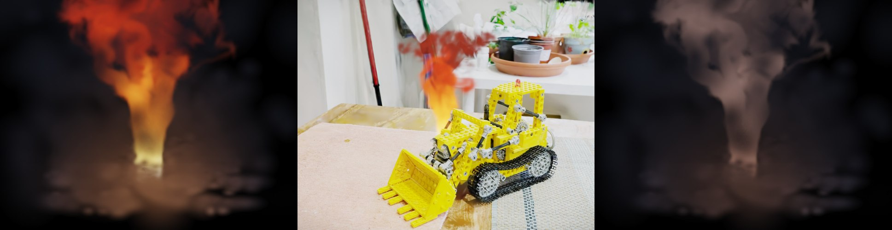

# Vortex Gaussians: Simulation-Driven Fire and Smoke as Native Gaussian-Splatting Content

### [[Project Page](https://seanwilliam2077.github.io/VortexGaussians/)] [[Paper (PDF)](static/vortex_gaussians_paper.pdf)] [[Live Demo](https://seanwilliam2077.github.io/VortexGaussians/demo/)] [[Solver Comparison](https://seanwilliam2077.github.io/VortexGaussians/compare.html)] [[Supplemental](static/vortex_gaussians_supplemental.pdf)] [[Video](static/video/vortex_gaussians_supplemental.mp4)] [[Hero clip](static/video/vortex_gaussians_hero_scene.mp4)] [[Captured-scene clip](static/video/vortex_gaussians_kitchen.mp4)] [[Omniverse clip](static/video/vortex_gaussians_farmland_ov.mp4)]

Zijun Xiao<sup>1</sup>

<sup>1</sup> Georgia Institute of Technology &mdash; [zxiao316@gatech.edu](mailto:zxiao316@gatech.edu)

[](https://seanwilliam2077.github.io/VortexGaussians/)

*We present a system that generates fire and smoke by forward physical simulation and renders them as native Gaussian-splatting content. Our key insight is a structural isomorphism: Lagrangian vortex particles and 3D Gaussians are the same class of point primitive, so one particle set serves simultaneously as simulation state and render primitive — position maps to the Gaussian mean, temperature to emissive blackbody color, density to opacity, and velocity gradient to an anisotropic covariance — with no voxelization, meshing, or simulation-to-renderer conversion anywhere. Each splat is itself a Lamb–Oseen vortex element: velocity, its analytic gradient and temperature are closed-form evaluations of the rendered Gaussian mixture under a Barnes–Hut treecode, with no Poisson solve, no linear solve and no grid. One depth-sorted emission–absorption rasterizer composites flame, smoke, embers and reconstructed 3DGS scenes with per-primitive mutual occlusion.*

- **Real time for the fire, no build step.** The whole system — simulation, sorting, rendering, UI — is one dependency-free HTML file. The fire alone runs at 58 FPS at 9 layers × 600 particles on a desktop RTX 3080 and 22 FPS on an integrated Radeon GPU at 1280×800, with the simulation single-threaded in CPU JavaScript. Inside a 729,826-splat capture the frame is 292 ms (3.4 FPS); the deficit is rasterization.
- **Grid-free.** A Barnes–Hut treecode (θ = 0.9) evaluates velocity, its analytic gradient and temperature directly from the Gaussian mixture — up to 15.3× faster than the exact sum at matched particle counts. A vortex-in-cell solver is retained as a live A/B baseline.
- **Burns real captures, offline.** Combustion state (heat / fuel / char / glow) lives on the loaded scene's own splats: the flame ignites the reconstruction, charring writes into splat albedo, and burning geometry re-seeds the solver with new plumes. On a capture this loop is six to eleven times slower than real time.
- **Lights and feels the scene.** Flame particles cluster into six world-space point lights that shade each splat, and nearby opaque geometry deflects the plume through closed-form boundary terms, with no grid added.

Development log: [CHANGELOG.md](CHANGELOG.md).

## Quick Start

```shell
git clone https://github.com/Seanwilliam2077/VortexGaussians.git
cd VortexGaussians

# option 1: just open demo/index.html (any WebGL2 browser — Chrome / Edge / Firefox)
# option 2: serve locally, needed only if your browser blocks file:// workers
python -m http.server 8000   # then open http://localhost:8000/demo/
```

The demo panel's top section chooses the solver: **Grid Mode** (the VIC baseline, one 32×48 velocity grid per slice) or **Grid-Free** (the Gaussian VPM). [`compare.html`](https://seanwilliam2077.github.io/VortexGaussians/compare.html) runs both side by side in lockstep — same seed, timestep, renderer and control stream, differing only in the solver, with per-side cost measured live on your machine.

Deterministic replay: `window.__demo.reset(seed)` + `.step(n)` + `.hash()` reproduce any run bit-exactly.

## Controls

| Control | Effect |
| --- | --- |
| **drag canvas** | orbit the camera (auto-orbit resumes on release) |
| **Shift + drag** | move the fire source; the plume follows with vortical lag |
| **`1` / `2` / `3`** | all layers procedural / VIC baseline / grid-free Gaussian VPM (hot-swap, same renderer) |
| **`F` / `S`** | fire / smoke shading of the same particle state |
| **`Space` / `R`** | pause / reset |
| **`Sim Layers` slider** | per-layer solver hot-swap (0 … N) |
| **`View-aligned / World-fixed`** | slice-orientation ablation (edge-on collapse of world-fixed) |
| **`Fire lights the scene`** | world-space fire light from clustered flame particles (render only, replay hashes unchanged) |
| **`Scene deflects the flame`** | sphere proxies from opaque splats, closed-form boundary terms (Grid-Free only; changes replay hashes) |
| **panel sliders** | buoyancy, baroclinic gain β, cooling, coupling c, inter-slice κz, covariance gain, exposure/bloom, … |

## Key Parameters

| Parameter | Default | Effect |
| --- | --- | --- |
| `layers` × `ppl` | 9 × 600 (1300 quality) | view-aligned slices × particles per slice; every slice runs an independent grid-free solve |
| `couple` (c) | 0.5 | velocity nudge toward the 16×24 coarse global solver — 0 = independent slices, 1 = slaved to bulk motion |
| `baro` (β) | 1.4 | baroclinic source Γ̇ = β·∂T/∂x — the temperature → buoyancy → vorticity loop that rolls plume edges |
| `covStretch` | 1.3 | flow-driven covariance Σ̇ = LΣ + ΣLᵀ, determinant-renormalized with an aspect clamp |
| `interZ` (κz) | 0 (off) | inter-slice vorticity exchange `ω_k += Δt·κz·(ω_{k−1}+ω_{k+1}−2ω_k)`; conserves circulation. An exchange rate, not a diffusivity (no 1/Δz²), so not comparable across slice counts |

## Custom Scenes

Load your own Gaussian-splatting reconstruction and light a fire inside it:

1. Train a scene with [Inria 3DGS](https://github.com/graphdeco-inria/gaussian-splatting), or use any binary little-endian `.ply` in that format. To try it immediately: [`static/test_scene.ply`](static/test_scene.ply) (45,808 splats, the campfire scene from the paper).
2. In the demo panel, open **Scene** and load the `.ply` (subsampled to a configurable budget, default 120k splats).
3. The scene merges into the same global depth order as the fire, so foreground geometry occludes the flame per primitive (`sceneSorted` toggles the naive draw-after baseline).
4. Place the fire with `sceneScale` / `sceneYaw` / `sceneLift`, then ignite it: `P.spreadOn` + `__demo.ignite(x, y, z, r)`.

## Repository Structure

```
index.html        # project page (self-contained; occlusion comparison slider, embedded demo)
demo/index.html   # the complete system: single-file WebGL2 prototype (~197 KB)
compare.html      # side-by-side grid vs grid-free solver comparison
static/           # paper and supplemental PDFs, compressed figures, videos, sample .ply scene
paper/            # LaTeX source of the paper, rebuilt from the published PDF (see paper/README.md)
tools/harness.py  # headless runs: replay hashes, GPU-synced timings, deflection stats, Hero stills and video
study/            # 2AFC perceptual study, with the pre-registered analysis in analyze.py
CHANGELOG.md      # development log
PUBLISH.md        # page-deployment checklist (GitHub Pages)
```

## Status

Delivered: supplemental video, benchmark tables on three GPUs with deterministic replay, energy-spectrum E(k) validation against a true-3D reference, occlusion and fire-spread figures on real captured `.ply` reconstructions, multi-source in-scene ignition, world-space fire light and geometry deflection.

Still open: the perceptual study has no participants yet ([study/README.md](study/README.md)); the integrated-GPU point is a desktop Ryzen part, not a laptop; the fire light and automatic deflection proxies are not yet measured on `kitchen` or `treehill`.

## Citation

```bibtex
@misc{xiao2026vortexgaussians,
  title  = {Vortex Gaussians: Simulation-Driven Fire and Smoke
            as Native Gaussian-Splatting Content},
  author = {Zijun Xiao},
  year   = {2026},
  note   = {Preprint, under review}
}
```

## Acknowledgements

The layered two-level architecture builds on Horvath & Geiger's production fire system (SIGGRAPH 2009); the rasterizer implements the forward pass of [3D Gaussian Splatting](https://repo-sam.inria.fr/fungraph/3d-gaussian-splatting/) (Kerbl et al. 2023). The project page adapts the layout of [Nerfies](https://nerfies.github.io/) and [FieryGS](https://pku-vcl-geometry.github.io/FieryGS/); the README follows the format of [PhysGaussian](https://github.com/XPandora/PhysGaussian).
