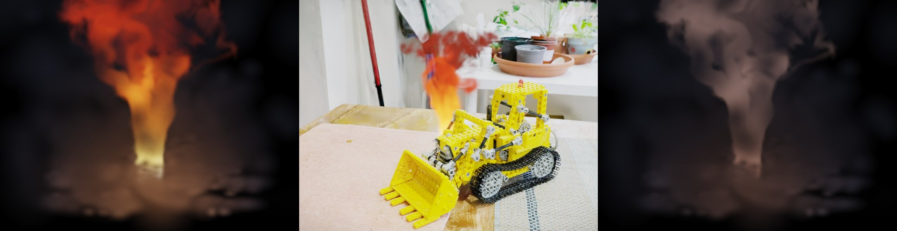

# Vortex Gaussians: Real-Time Simulation-Driven Fire and Smoke as Native Gaussian-Splatting Content

**Two ongoing research tracks:** [TOG-oriented smoke editing](tracks/tog/README.md) and [Combustible Digital Memory — art research](tracks/art/README.md) now share this repository. The original browser prototype remains the creative platform; the technical contribution and artistic argument are being investigated separately. Start with the [dual-track workspace](tracks/README.md), [current tasks](tracks/STATUS.md), and [compact historical evidence](tracks/evidence/README.md). Neither track currently claims publication readiness.

### [[Project Page](https://seanwilliam2077.github.io/VortexGaussians/)] [[Historical manuscript (PDF)](static/vortex_gaussians_paper.pdf)] [[Evidence status](research/EVIDENCE_STATUS.md)] [[Live Demo](https://seanwilliam2077.github.io/VortexGaussians/demo/)] [[Solver Comparison](https://seanwilliam2077.github.io/VortexGaussians/compare.html)] [[Video](static/video/vortex_gaussians_supplemental.mp4)] [[Captured-scene clip](static/video/vortex_gaussians_kitchen.mp4)] [[Omniverse clip](static/video/vortex_gaussians_farmland_ov.mp4)]

Zijun Xiao<sup>1</sup>

<sup>1</sup> Georgia Institute of Technology &mdash; [zxiao316@gatech.edu](mailto:zxiao316@gatech.edu)

[](https://seanwilliam2077.github.io/VortexGaussians/)

*Vortex Gaussians is a browser prototype for vortex-driven fire and smoke rendered as Gaussian splats. The default layered mode maps vortex-particle positions and visual attributes to render primitives: temperature controls emissive color, density controls opacity, and velocity gradients drive an anisotropic covariance. This shared storage is an implementation choice; simulation kernels and rendering covariances are not asserted to define the same field. The layered VPM uses regularized vortex-kernel evaluations and a Barnes–Hut approximation. Depth-interleaved splat compositing combines the dynamic effects with reconstructed 3DGS scenes. Separate research paths test numerical correctness and alternative state representations; they do not establish a new method advantage or physical accuracy for the complete fire system.*

The linked PDF and media are historical materials. Their claims and measurements predate the current audit; see [Evidence status](research/EVIDENCE_STATUS.md) for current results and limitations.

- **Interactive browser demo, no build step.** Simulation, sorting, rendering and UI are in one dependency-free HTML file. The author historically reported ~60 FPS at 9 layers × 600 particles on a desktop RTX 3080 at 1280×800, with single-threaded CPU JavaScript simulation. This layered-mode measurement was not rerun in the current audit.
- **Grid-free layered VPM mode.** This mode uses a Barnes–Hut treecode (θ = 0.9) without a fluid grid or pressure projection. The author reported up to 15.3× over exact summation at matched particle counts in the historical configuration; this was not remeasured here. The VIC comparison uses grids, and separate research paths have their own discretizations.
- **Heuristic fire spread on captures.** Heat / fuel / char / glow states live on loaded scene splats; threshold heating changes their appearance and can re-seed layered plumes. These visual controls are not calibrated material properties. The separate fixed-parcel 3D thermal tests do not validate this combustion model.

Development log: [CHANGELOG.md](CHANGELOG.md).

## Quick Start

```shell
git clone https://github.com/Seanwilliam2077/VortexGaussians.git
cd VortexGaussians

# option 1: just open demo/index.html (any WebGL2 browser — Chrome / Edge / Firefox)
# option 2: serve locally, needed only if your browser blocks file:// workers
python -m http.server 8000   # then open http://localhost:8000/demo/
```

The demo panel's top section chooses the solver: **Grid Mode** (the VIC baseline, one 32×48 velocity grid per slice) or **Grid-Free** (the Gaussian VPM). [`compare.html`](https://seanwilliam2077.github.io/VortexGaussians/compare.html) synchronizes the seed, timestep, renderer and control stream, with per-side cost measured live on your machine. This is an implementation comparison, not a matched-accuracy physical benchmark.

Deterministic replay: `window.__demo.reset(seed)` + `.step(n)` + `.hash()` supports simulation-state comparisons for fixed code, configuration, inputs and runtime. Replay does not make wall-clock timings or results across platforms bit-reproducible.

## Coupling Research Diagnostics

Start with [Evidence status](research/EVIDENCE_STATUS.md), which separates the historical demo, browser correctness repairs, the isolated standard physical reference, and the shared-state/proxy architecture screens. The following commands run the original P0 harness.

The self-contained [research harness](research/README.md) runs a synthetic 2×2 coupling ablation and tests sensitivity to splat duplication, input order, and processing quotas. It requires Node.js 20+ and Playwright with Chromium or Edge; the interactive demo still has no build step. The [experiment protocol](research/PROTOCOL.md) defines the controls and the limits of these measurements.

```shell
cd research
npm install
npx playwright install chromium
npm test
npm run smoke
node run.mjs --suite all --out runs/p0
```

Each run saves the source fingerprints, browser and hardware metadata, complete configuration, per-splat combustion snapshots, and sampled CSV measurements. The experimental API adds stable scene IDs, separate flame-to-scene and scene-to-solver switches, complete external-source cutoff for layered VPM, and actual heat/emission/quota counters. The released coupling equations and default quotas are preserved. These synthetic diagnostics establish implementation behavior; they do not measure full-scene frame latency or establish physical accuracy.

The subsequent [P1 comparisons](research/P1_README.md) test opt-in elapsed combustion clocks and cold-particle reuse. The original policies remain the defaults; the P1 protocol measures both their intended effects and their graph-propagation and discarded-state tradeoffs.

The [P2 comparisons](research/P2_README.md) test explicit surface-area weights for graph heating and scene-to-particle feedback. They distinguish coincident-splat splitting from actual spatial refinement, with fixed-domain uniform and adaptive grids. Area mode is an opt-in synthetic research path; it requires authored measures and does not infer a physical surface area from ordinary 3DGS covariance or opacity.

## Controls

| Control | Effect |
| --- | --- |
| **drag canvas** | orbit the camera (auto-orbit resumes on release) |
| **Shift + drag** | move the fire source; the plume follows with vortical lag |
| **`1` / `2` / `3`** | all layers procedural / VIC baseline / grid-free Gaussian VPM (hot-swap, same renderer) |
| **`F` / `S`** | fire / smoke shading of the same particle state |
| **`Space` / `R`** | pause / reset |
| **`Sim Layers` slider** | per-layer solver hot-swap (0 … N) |
| **`View-aligned / World-fixed`** | slice-orientation ablation (edge-on collapse of world-fixed) |
| **panel sliders** | buoyancy, baroclinic gain β, cooling, coupling c, inter-slice κz, covariance gain, exposure/bloom, … |

## Key Parameters

| Parameter | Default | Effect |
| --- | --- | --- |
| `layers` × `ppl` | 9 × 600 (1300 quality) | view-aligned slices × particles per slice; every slice runs an independent grid-free solve |
| `couple` (c) | 0.5 | velocity blend toward a coarse guiding field: tree-derived in VPM mode, a 16×24 grid in VIC mode — 0 = independent slices, 1 = fully guided |
| `baro` (β) | 1.4 | baroclinic source Γ̇ = β·∂T/∂x — the temperature → buoyancy → vorticity loop that rolls plume edges |
| `covStretch` | 1.3 | flow-driven covariance Σ̇ = LΣ + ΣLᵀ, determinant-renormalized with an aspect clamp |
| `interZ` (κz) | 0 (off) | inter-slice vorticity exchange `ω_k += Δt·κz·(ω_{k−1}+ω_{k+1}−2ω_k)`; conserves circulation. An exchange rate, not a diffusivity (no 1/Δz²), so not comparable across slice counts |

## Custom Scenes

Load your own Gaussian-splatting reconstruction and light a fire inside it:

1. Train a scene with [Inria 3DGS](https://github.com/graphdeco-inria/gaussian-splatting), or use any binary little-endian `.ply` in that format. To try it immediately: [`static/test_scene.ply`](static/test_scene.ply) (45,808 splats, the synthetic campfire scene from the paper).
2. In the demo panel, open **Scene** and load the `.ply` (subsampled to a configurable budget, default 800k splats).
3. The scene and fire are depth-interleaved: the dynamic stream is exactly sorted, while scene depths are bucketed. This supports approximate per-primitive occlusion (`sceneSorted` toggles the naive draw-after baseline).
4. Place the fire with `sceneScale` / `sceneYaw` / `sceneLift`, then ignite it: `P.spreadOn` + `__demo.ignite(x, y, z, r)`.

## Repository Structure

```
index.html        # project page (self-contained; occlusion comparison slider, embedded demo)
demo/index.html   # single-file WebGL2 visual prototype and browser research APIs
compare.html      # side-by-side grid vs grid-free solver comparison
research/         # portable coupling diagnostics, protocol, tests and browser runner
static/           # paper PDF, compressed figures, the three videos, sample .ply scene
CHANGELOG.md      # development log
PUBLISH.md        # page-deployment checklist (GitHub Pages)
```

## Status

Preprint. Historical materials include author-reported layered-mode timings, visual examples on captured `.ply` scenes, and a negative-leaning energy-spectrum comparison with a 3D implementation. They are not newly replicated full-system measurements.

Current audits verify narrower contracts: finite-capacity 3D thermal coupling (P4b), a native thermal-query repair (P5b), and an isolated standard Gaussian-vortex reference (P5c). The P7b controlled screen found that 2048 independent thermal states could meet the same 2% response/display tolerances as 8192 shared states, with a median paired CPU-to-display-temperature-buffer time ratio of 0.2730 and lower accounted array storage. This is a prescribed-motion thermal task, not a renderer, VPM or full-frame speedup. Full-system physical accuracy, real-scene material calibration and a distinct method advantage remain unestablished. See [Evidence status](research/EVIDENCE_STATUS.md) for protocols, provenance and limitations.

## Citation

```bibtex
@misc{xiao2026vortexgaussians,
  title  = {Vortex Gaussians: Real-Time Simulation-Driven Fire and Smoke
            as Native Gaussian-Splatting Content},
  author = {Zijun Xiao},
  year   = {2026},
  note   = {Preprint}
}
```

## Acknowledgements

The layered two-level architecture builds on Horvath & Geiger's production fire system (SIGGRAPH 2009); the rasterizer implements the forward pass of [3D Gaussian Splatting](https://repo-sam.inria.fr/fungraph/3d-gaussian-splatting/) (Kerbl et al. 2023). The project page adapts the layout of [Nerfies](https://nerfies.github.io/) and [FieryGS](https://pku-vcl-geometry.github.io/FieryGS/); the README follows the format of [PhysGaussian](https://github.com/XPandora/PhysGaussian).
