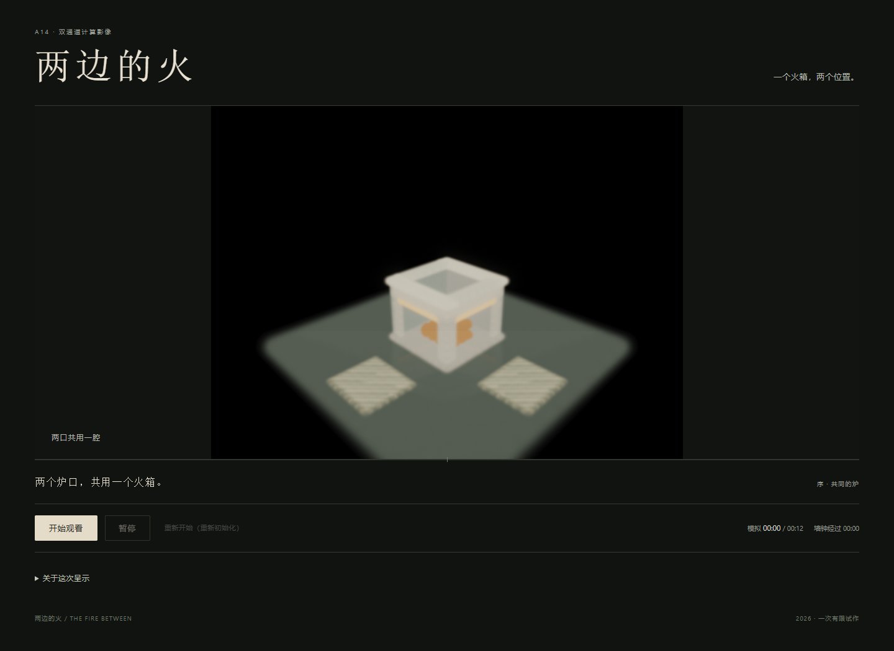
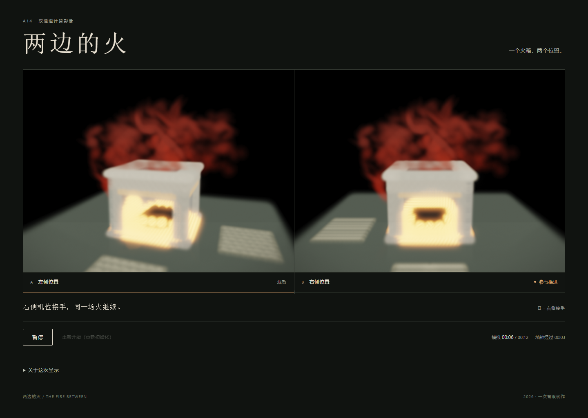

# A14《两边的火》

2026-10-30。一件实际完成有限序列的本地网页小样：[打开作品](index.html)。新合成双口炉、两块地垫、等大的双画面，一次点火后两方依次参与生成；交接继承已有计算状态。它不使用用户私人记忆，也不模拟真实取暖份额。

[制作前决定](INTENT.md)、[提案](PROPOSAL.md)、[具体实现与时间谱](WORK_SPEC.md)、[实际过程](PROCESS.md)、[邻近实践](CONTEXT.md)和[论证短稿](PAPER_DRAFT.md)组成当前评审包。短稿明确区分“状态确实接续”和“继承经验尚未充分成立”；不是已获接受或格式完备的投稿论文。

实际5381点、360步、12模拟秒；一次reset和ignite，第180步交接不改变除yaw外的公开导出状态。唯一检查父命令12.2382966秒，脚本内部11.9370688秒；六张实际阶段图、无页面或控制台错误、来源未变、资源关闭。保存资料见[inspection-01/result.json](inspection-01/result.json)。这些是实现和记录事实，不是艺术分数。

此次实际检查使用与正常播放相同的step/render函数，但未连续录像，末尾后退只检查终点。实际阶段图中，共同对象清楚了一些，交接关系仍主要依赖文字，炉体整体发光也削弱了取暖造型。不能用阶段图断言连续节奏必然失败；也不能把不存在的完整观赏补写为证据。

作品必须通过仓库本地HTTP服务打开；无需安装或构建。例如从仓库根目录运行 `python -m http.server 8000 --bind 127.0.0.1`，访问 `/tracks/art/studies/a14-view-authored-object/`。正常播放有明确起止，结束后重新开始会重新初始化；无自动循环、个人存储或远程素材。每次运行是新的计算，不是重放已有录像。原demo、main和旧作品保持。

[独立评审](../../../validation/art-a14-review-round-01.md)：A14总体**3/6 Weak Reject**、准备度5/10、置信度3/5。评审指出静帧不足以关闭完整时序形式；[回应](RESPONSE_ROUND_01.md)保留短稿并更正该过早结论。[下一决定](DECISION.md)只补一次同一冻结版本的正常播放记录，不调效果或改门。A09+A10历史分数保持其原对象范围，5/6目标尚未满足。
