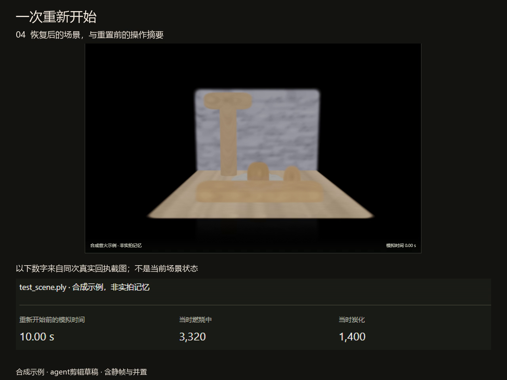
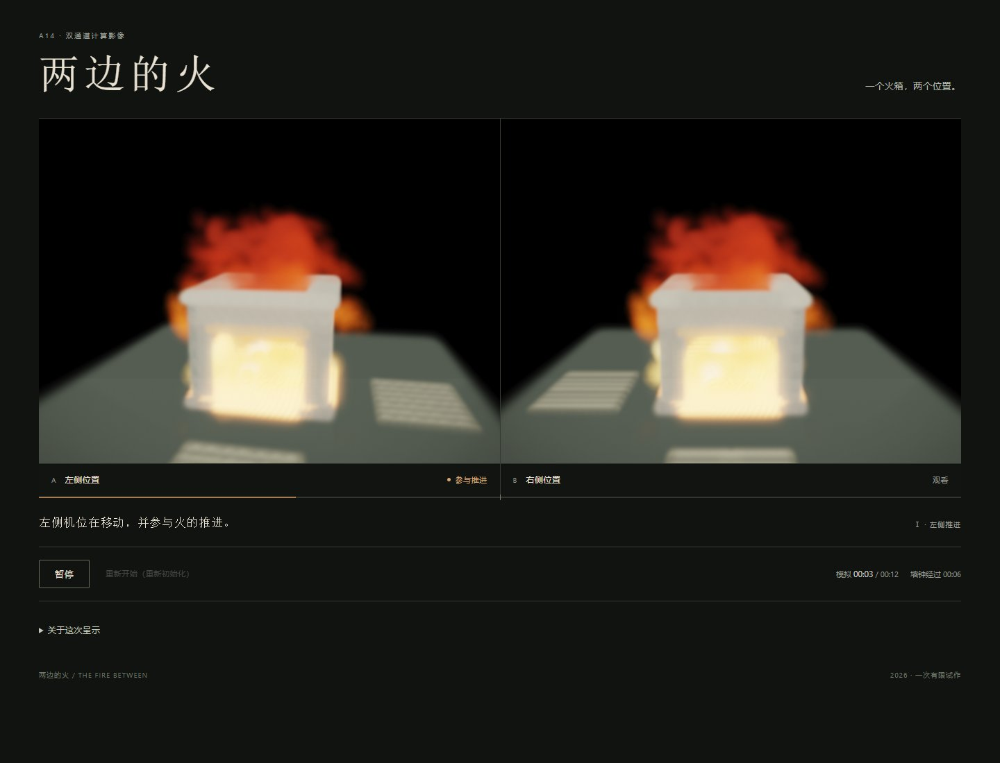
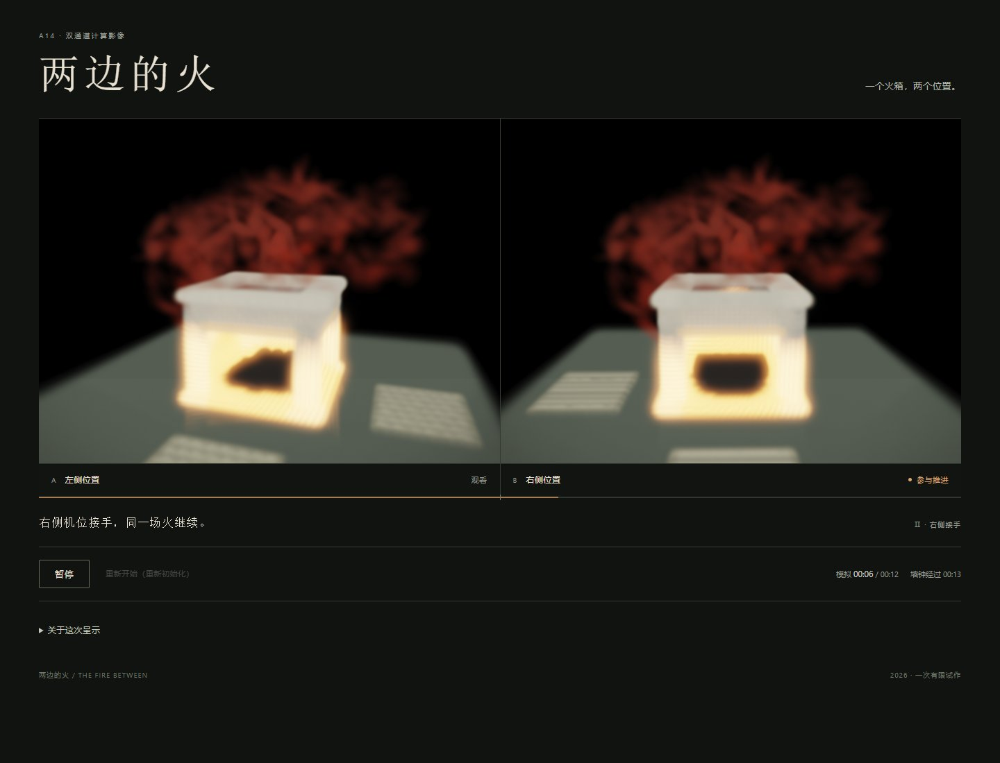
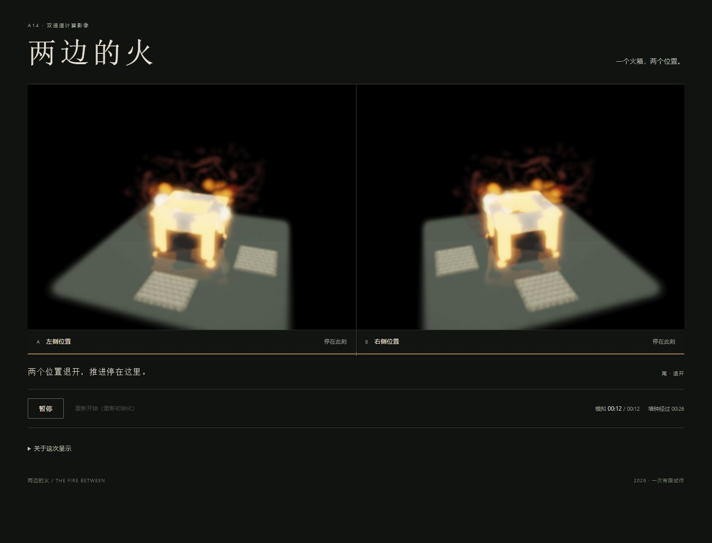

# 留下之后，给多少分量：三次数字燃烧实践中的保留与编辑代价

## 摘要

本文回顾《一次重新开始》《两边的火》《下次张贴之前》中的三次编辑选择：在恢复场景下留下旧摘要，给予先后参与生成的两方等大画幅，以及允许观者将原话放回处理图像旁。它们分别保存了操作读数、观看位置和请求全文，也接受了不同的表达代价。本文主张，参照的可取得性与它能提供的比较依据需要分别判断；增加数量、画幅或操作选择，不能相互替代。三案的联系不在证明模拟图像不真实，而在相互限制“再留下更多便能补足”的创作直觉。这个回顾性论证保留各作尚未充分成立的关系，不将它们重标为成功作品。

## 一、保留作为一个需要解释的选择

这条实践沿用VortexGaussians的模拟火平台，以合成对象探索暂名“可燃的数字记忆”的方向。对象与故事由Agent创作，用户没有提供私人记忆。平台能生成明亮、持续变化的火，也能重新初始化状态；作品的保存、继承和未来请求，却要由具体编排建立，不能由火的存在自动回答。

本文关注的不是给火寻找统一象征，而是作者怎样安置火之外仍需比较的东西。保留具有积极理由：它可以阻止当前图像独占对先前行动的说明，避免一个观看位置成为唯一正面，或让原话限制颜色引出的解释。但保留也会改变材料的形态、位置和出现条件。因此，艺术判断需要追问：留下什么以后，哪项比较变得可能，又有哪项比较不再由当前画面提供？

三作并非预先设计的递进实验。下述意图来自各自制作前的决定；将它们连成相互制约的论证，是本文现在的回顾性选择。分析固定使用六张既存图与制作记录，没有重新运行或改变作品。它不能证明普遍观众效果，也不要求三个案例分别创造一套新理论。

## 二、《一次重新开始》：用精确摘要留下不完整的过去

图1中央是恢复后的浅色场景，下方排列旧摘要。场景显示零秒，摘要显示十秒以及“当时燃烧中”“当时炭化”的读数；两种时间被明确区分。没有火的当前图像占据较大面积，先前行动以较小的文字和数值进入结尾。

[A07制作前意图](../a07-return-and-record/INTENT.md)规定先呈示原状、燃烧和重置，最后把恢复场景与同次重置前的摘要上下并置。裁切去掉页面操作区，摘要另行放大，结尾按计划停留。这是一项已经实施的编辑选择，不是对原界面同屏状态的发现。[制作记录](../a07-return-and-record/README.md)确认实际剪辑草稿成立；本文只直接看过其所选末镜头，不能据此判断整片节奏。

这个选择取得了两种清晰性。其一，当前无火不再是结尾唯一提供的事实；其二，旧数字准确保存公共摘要的读数，避免由作者重写一段模糊的“曾经燃烧过”。它们不是损毁程度的视觉替身，却能具体标明记录指向哪次操作。摘要因其概括而可辨，概括本身并非低意义的形式。

代价发生在结尾的比较方式：此前燃烧的形貌不再同时出现，观者可对照当前外观与旧读数，却不能在这一镜头内直接比较前后火形。过去因此成为有选择的索引。这个结尾没有删除整片的燃烧段或档案；本文也没有理由要求它展示一切。关键是作者选择了可核对的数值，而接受形貌比较退出末镜头。

这使“留下记录”成为具体取舍。若只把它理解成摘要面积太小、应让过去获得更多画幅，便会把保存问题简化成布局配额。下一案例恰好限制这种补救。删去A07，论证也会失去这一点：保留能够同时增加精确性、缩减结尾可比较的内容，不能用完整／贫乏两端概括。

## 三、《两边的火》：完整视幅没有独自建立接续

| 图2：左侧推进 | 图3：交接附近 | 图4：退开阶段 |
|---|---|---|
|  |  |  |

三图中左右画幅相等，两格火形相近，炉与地垫的透视显示位置差别。推进身份由左换右，末段则保留两个远景。选图支持两处位置持续被呈示；谁在推进，首先通过画面下方的文字与标记得到明确说明。

[A14制作前决定](../a14-view-authored-object/INTENT.md)选择共腔双口炉、两块同形地垫和先后参与生成的机位，交接时不中断、不重置，结尾保留两方位置。等幅在这里有积极的形式作用：没有参与推进的一方仍获得完整观看空间，最后也没有裁出唯一正面。共同火箱与两个空位为两处观察提供具体落点，不只是两块抽象输出窗口。

[过程](../a14-view-authored-object/PROCESS.md)确认交接接续已有计算状态。它说明发生了什么操作，却不能代替“继承”在画面中是否有分量的判断。[旧稿](../a14-view-authored-object/PAPER_DRAFT.md)已经指出，可感的接续主要由文字宣布；本轮三图没有补足完整时序观看。火形近似、炉体整体发亮及身份标记的安排都参与可辨关系，不能把难辨单独归因于等大画幅。

这里的取舍不是“平等失败”。作者给足了两方观看面积，同时保留只有一方参与下一步生成的先后制度。两种资格没有自动变得同样清楚。作品由此成为本文的限制性案例：完整展示两边，尚不足以保证两边之间的关系获得表达。它没有证明实际取暖利益、人物经验或某一方受损，也没有证明完整播放必然无法产生接续感。

A14不是对A07改版的受控比较。但它阻止本文把“扩大保留部分”当作现成处方：面积回答了看见多少，未独自回答哪种先后正在发生。删去本组，保存问题容易再次被写成让参照更大、更完整；保留它，则必须把视幅与关系的可辨程度分开判断。

## 四、《下次张贴之前》：可返回与默认同现

| 图5：原话收起 | 图6：原话返回 |
|---|---|
|  |  |

三人共同声明中，叶青请求下次张贴不再列名，正文由另两人保留。故事为原创虚构。两图保持金色姓名与上方火形，右侧折痕换成请求卡片。原话没有改变中央图像，却将“希望下次怎样”具体放到“当前呈示什么”旁边。

[A25过程](../a25-public-request/PROCESS.md)说明开始处理先收起原话，随后可以放回；返回不推进材料。[第二稿](../a25-public-request/PAPER_REVISION_02.md)回述，原先期待亮火妨碍查看暗变，实际未获支持，后续保留了金色材料。可核对的形式变化是：A24固定的并置，在A25变为可逆显隐。本文不把现在的综合立场写成这些选择原有的统一动机。

返回取得了明确收益。金色可能指向纪念、荣耀或警示，原话则给出颜色不能代说的请求；在火与姓名保持时放回它，观者可以重新取得比较依据。作者因此不必替所有观看时刻预先决定原话是否同时可见。

但提供返回路径之前，作品先取消了无需操作的同现条件。增加控制没有自动增加比较的充分性；它也可能只是让观者恢复作者撤去的条件。这里仅需一次可逆操作，返回后原话可以保持，不能写成持续劳动、道德负担或已观察到的心理代价。当前保留姓名也未违反面向下次的请求；图像与开关都没有生成下一版声明。

A25限制了另一种补救直觉：当固定并置不够时，提供操作不必然更好。它确实改变由谁决定参照同现，却必须连同初始撤去一起评价。删去本组，本文会把表达分量全归于作者固定构图，遗漏比较条件也可以被交给观者改变。

## 五、三组怎样相互限制

三项代价不是同一种量，不能相加成为“总体损失”。A07的计数为过去提供精确索引，代价是末镜头不再同时给出燃烧形貌；A14保留完整视幅，却未保证先后资格同样可辨；A25保留请求全文和返回入口，同时撤去默认共现。

它们构成的联系是对补救办法逐项设限。A07不允许把摘要一律判为贫化，因为它确实取得精确性；A14不允许从形貌退出结尾直接推出扩大画幅足以补足关系；A25又不允许从固定编排的不足直接推出开放控制便能补偿。这样，作者不能用“都留下了”结束判断，而须说明保留材料究竟要完成哪项比较，以及所选形式实际允许什么。

这也是我对先前“留下更多参照”方向的修正。我的艺术立场不是追求信息俱全，而是让保留方式接受与其目的相称的判断：对历史读数而言，精确索引可以有意义；对先后生成资格而言，完整视幅仍需关系可辨；对未来请求而言，可返回的全文提供复查，却不能充当答复。这些标准来自不同内容，不应再用“处置”统一代称。

## 六、既有实践、增量与最强反读

文字参与识别行动，已有充分艺术先例。依资料Agent读取的[SFMOMA作品页](https://www.sfmoma.org/artwork/98.298/)，Rauschenberg的《Erased de Kooning Drawing》在取得同意后完成擦除，并由题记与装裱参与识别。因此，A07的摘要或A14的身份文字依赖，不能单凭“需要说明”便被判无效；应判断文字具体保存了什么，以及它与行动之间的关系。

同样，依已核查的[艺术家作品页](https://var-mar.info/visions-of-destruction/)，Varvara & Mar的《Visions of Destruction》已经以眼动参与景观变化，并在无人观看一段时间后引入再生。A14不能以观看参与生成、或换用火焰平台取得首创。依[理论核查记录](CONTEXT_PRESSURE.md)，Agre也已讨论技术词义伸缩及表征与对象的混同。本文沿用这些资料记录，未亲读所引外部正文或直接观看所引作品；Drucker全文未读，不据其姓名支撑论证。

最强反读仍成立为压力：摘要会删节、等大不等于叙事清楚、开关改变显隐，都是一般编辑常识。本文的有限增量不在发现这些原则，而在以三次已实施的保留选择组成相互牵制的判断：一种案例中取得的好处，不能直接成为另一案例的补救答案。A25单作没有过去由形貌转成计数的选择，也没有等幅与先后资格的张力；三篇分开的自评则容易各自停在“继续改进”的建议，无法显出这些建议之间的限制。

这仍不证明保留参照的新理论、媒介不可替代性或普遍观众效果。它提供的是一项由具体作品支持的批判性实践认识：保留本身就是编辑，保留数量、完整视幅和可调用性分别取得不同好处，也需要接受不同判断。旧作未实现的继承经验、未来答复或完整时间表达继续保留为未完成，不能因综合写作而补成成功。

## 图像、来源与作者范围

本文图像分析固定于已直接查看的图1至图6。图1为A07既有解码检查图；图2至图4为[A17](../a17-saved-sequence-reading/README.md)从A16已保存正常序列复制的原JPEG，不是视频解码，本轮未重新核验哈希；图5至图6为A25原检查PNG。本文未连续观看三作，没有新增模拟、素材、检索或真人反馈。制作意图与过程来自文中链接；外部实践沿用[A25 CONTEXT](../a25-public-request/CONTEXT.md)及[A14 CONTEXT](../a14-view-authored-object/CONTEXT.md)所载资料Agent成功读取的一手正文。作品、过程记录与本文均由Agent参与完成，用户没有提供本文中的经历。
