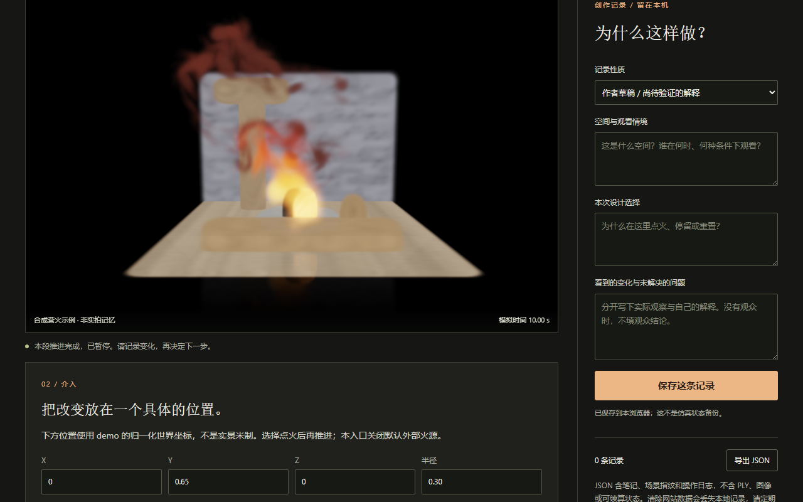
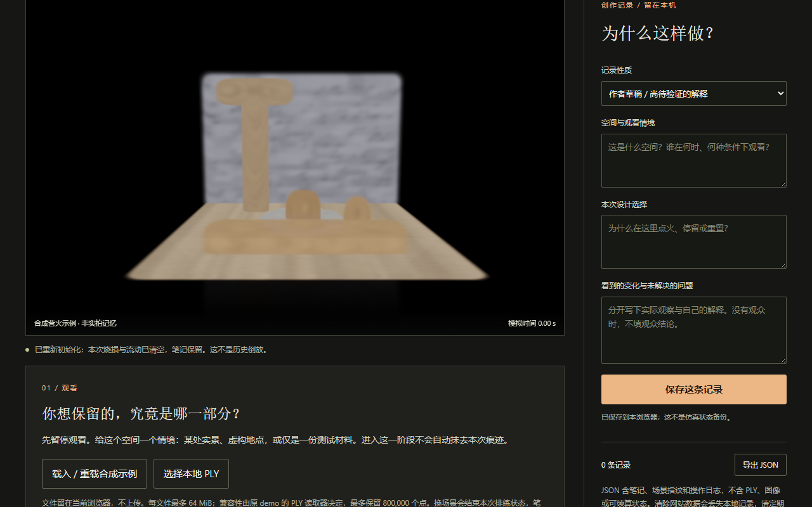
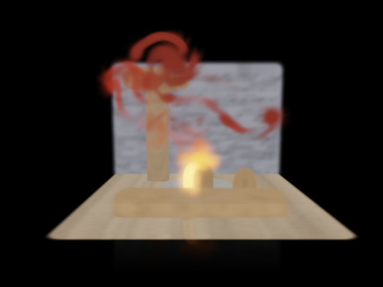
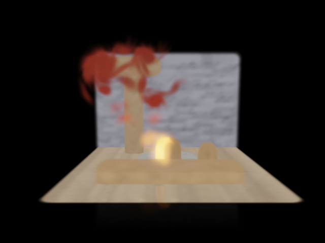
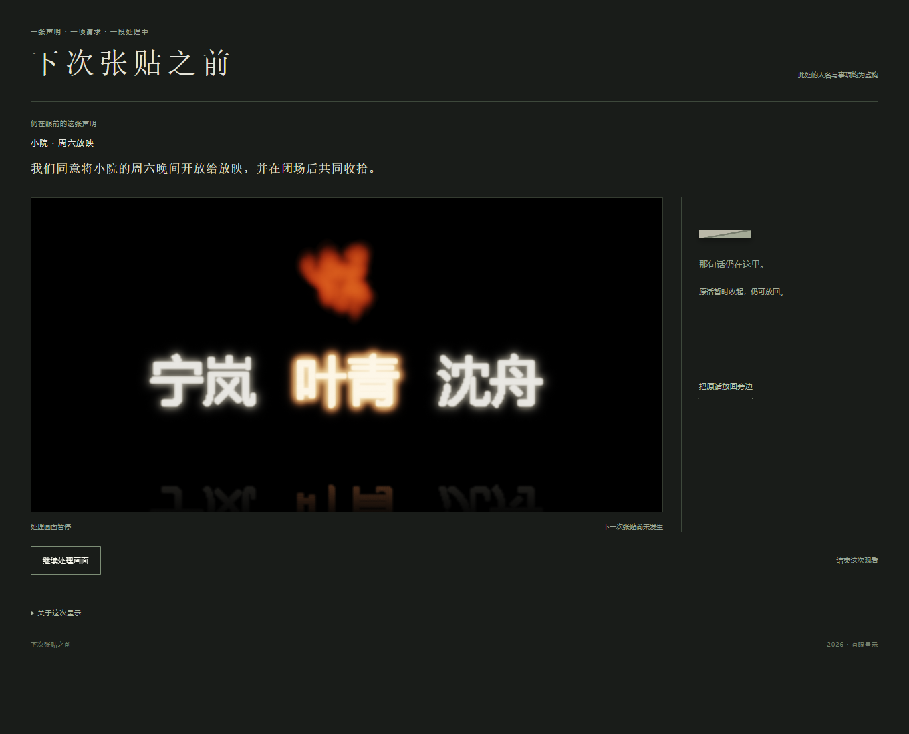
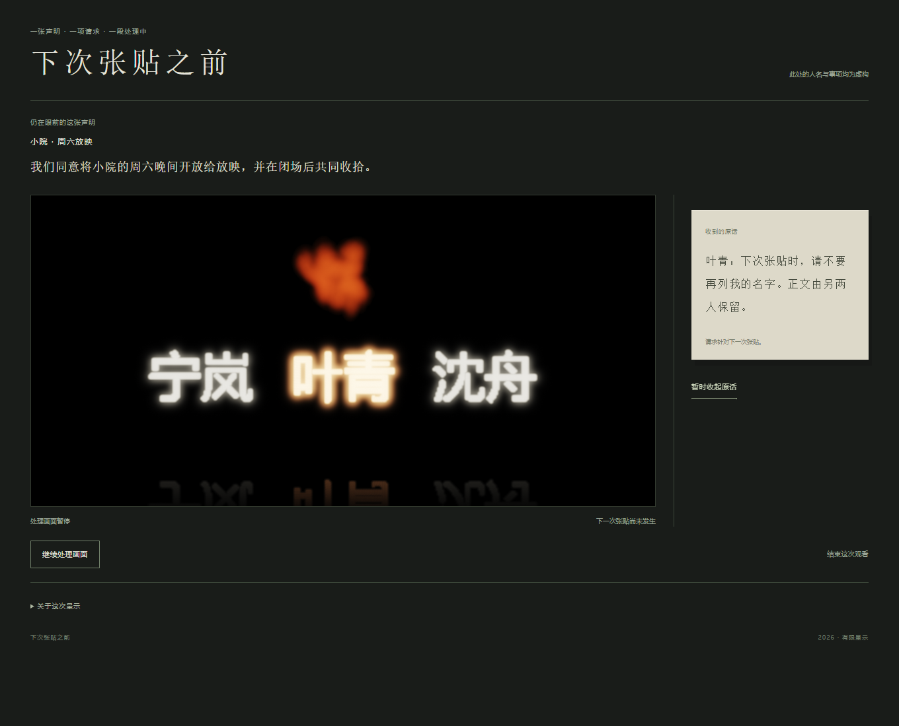

# 六图分析原型：火不能代答？

2026-10-31。固定三组旧图；分析不等于完成论文或新作品。

## A06：恢复画面与留下摘要

| 十秒后 | 重置后 |
|---|---|
|  |  |

图像：亮火下有小片深色；重置后两者消失，暖黄色物件仍在。局部明暗不能说明所有燃尽点均可见，更不能证明几何消失后复原。

制作：记录说明保留几何与默认不透明度，重置重新初始化燃烧状态，另留不能续算的摘要。原记录已限定“焦化”的可见程度与“重置”的范围；六图没有显示一次因该发现而实施的界面修改。因此，把本组读成对数字保存承诺的批判，是当前解释，不能倒写成已经完成的创作转向。它留下的具体问题是：既然摘要不能恢复燃烧画面，为何要把它作为结尾保存？本组没有充分回答。

## A13：生成镜头与观看镜头

| 零度生成后统一观察 | 九十度生成后统一观察 |
|---|---|
|  |  |

图像：上部红色火形的分支与范围不同，物件轮廓相近，未见可辨的不同烧痕。

制作：两次生成固定对象和点火，改变生成视角，截图统一观察镜头。记录支持热量与点燃分类有差异，燃料、焦化、余辉无差异；后者有时钟配额解释。这把“火看起来不同”与“燃料消耗不同”分开，不能把观察镜头的一致当作生成条件的一致。现有材料没有展示这一结果随后改变了作品名称、操作或表达承诺。把它称为观看的权力，仍是本轮加上的解释，不能由相机参数进入计算直接推出。

## A25：同一姓名与返回的原话

| 原话收起 | 原话返回 |
|---|---|
|  |  |

图像：金色姓名与火形保持，旁边折痕换为请求文字。姓名醒目可辨，未表现撤名。

制作：过程记录确认返回原话不推进材料。第二稿回述最初“亮火妨碍查看暗变”的期待未获支持；可确认的后续选择，是保留金色材料，并将A24固定并置改为可收起、可返回的原话。这里实际改变的是比较条件，未完成的仍是下次张贴时的署名修改。两图支持编排发生过变化，却不足以独立证明该变化由先前材料失望导致。没有观众误认、遗忘或接受这种安排的证据。

## 删减检验与理论增量

删A06，会失去“恢复外观不等于保有可续算历史”的保存机制辨析，A25没有重置或回执，不能支持它；但这条辨析主要由记录承担，尚未成为充分的作品关系。

删A13，会失去“统一观看位置仍容纳不同生成条件”的论证，A25原话开关没有改变生成过程，不能支持它；但这是材料诊断，尚无承诺因之改变的创作证据。

因此，两组各有不可互换的事实，却未提供不可删去的艺术研究论证。据已读理论核查，Agre已覆盖表征／对象混同及技术词义伸缩。六图增加了外观恢复、燃料演进、原话显隐的具体区别，没有超出该命题的充分增量。A25的实际编排仍是主要艺术内容；综合暂不宜扩成长稿。把三种不同操作统称“处置”，反而会重复所批判的伸缩。

## 来源与范围

本轮沿用已直接看过的六图，无新增图像观看、运行、来源或真人反馈；A06回执未直接看图。Drucker仅有摘要，不据此扩展论证。

- [A06制作记录](../a06-char-and-reset/README.md)
- [A13制作记录](../a13-camera-coupling/README.md)及[限制解释](../a13-camera-coupling/LIMITATION.md)
- [A25过程](../a25-public-request/PROCESS.md)及[第二稿回述](../a25-public-request/PAPER_REVISION_02.md)
- [理论核查及访问边界](CONTEXT_PRESSURE.md)；Agre正文事实沿用此记录，本轮未另读原文。
