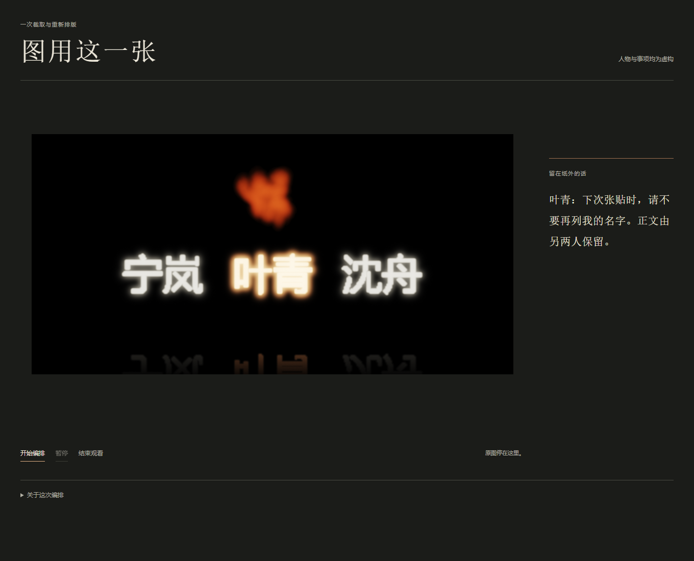
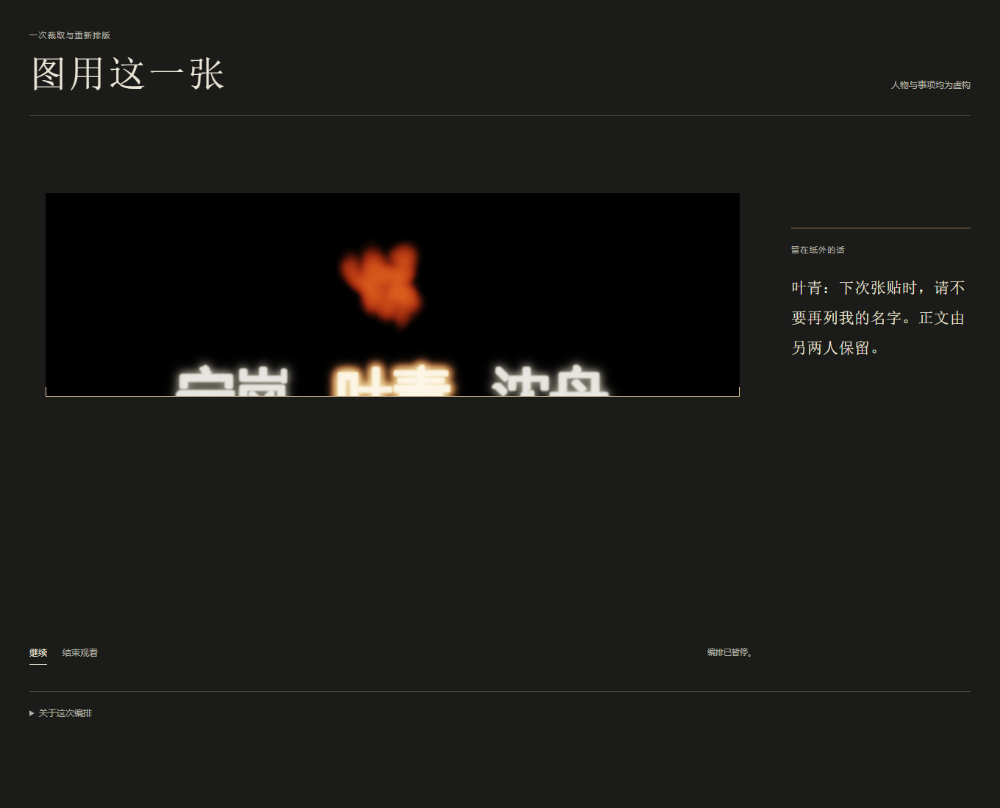
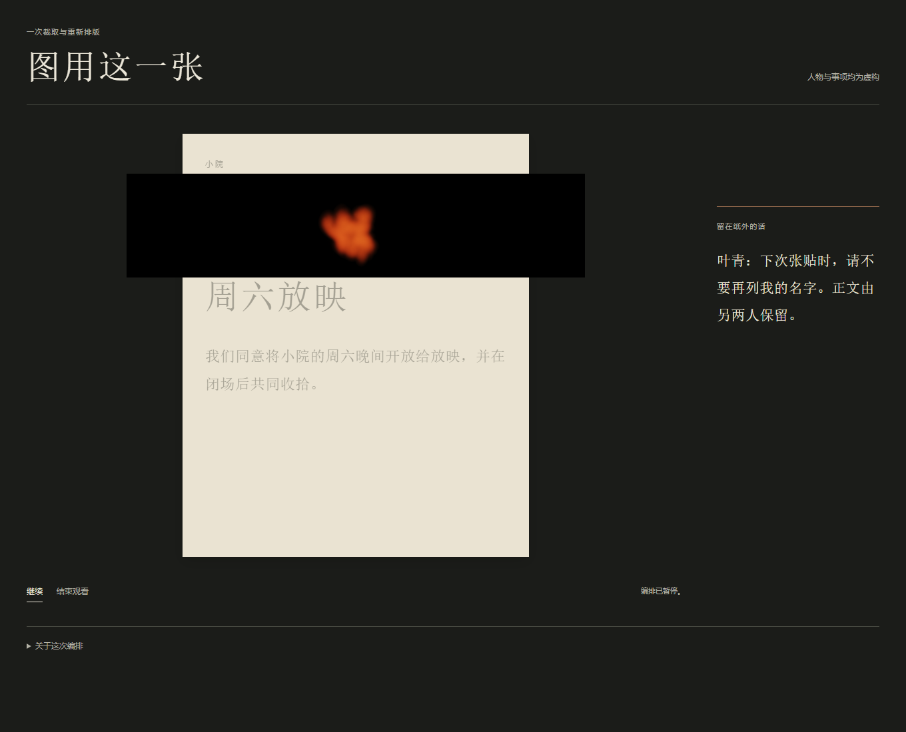

# 《图用这一张》：署名重排与处理图像的接用

## 摘要

《图用这一张》从一张三人姓名的处理图，编排出下一张小院放映告示。叶青请求下次不再列名，正文由宁岚、沈舟保留。作品将三个旧名字一起裁去，把同一源图的火形置于新告示上部，再在正文下重新排入另两人的名字。请求始终留在纸外。本文讨论这种不同去向：继续署名者以新文字承接声明，处理图像则脱离姓名，作为配图继续使用。名单的改变没有替作者决定图像的用途。四张既有画面支持对裁取、安置和重排的细读；它们也保留一个不足：最终火形很小，与放映内容没有直接叙事联系，整个安排仍可能只是一段普通裁图演示。

## 一、下一张告示怎样出现

作品的虚构声明是：“我们同意将小院的周六晚间开放给放映，并在闭场后共同收拾。”宁岚、叶青、沈舟原来同列。叶青提出：“下次张贴时，请不要再列我的名字。正文由另两人保留。”这个请求把两件事分开：一人不再署名，共同安排仍可继续。它没有要求焚毁整份声明，也没有规定下一张告示该用什么图。

观看开始时，一幅宽黑底图占据主要区域。三个大名字发亮，叶青呈金色，火形在其上方。随后，裁框下缘上收，越过整行姓名；剩下的火窗缩入一张竖幅纸面，标题、完整正文和两处署名排入。终点是一张可以阅读的新告示，纸外仍放着叶青的原话。观者能暂停或结束这段编排，不能投票替人物决定名单。裁哪一部分、怎样采用、谁以何种字形回来，都是作者作出的选择。

## 二、从材料变化转向编排

源图来自此前作品A25保存的第122步画面。原材料尝试没有让目标姓名变得难读，反而使其呈现金色；A25据此组织了请求与处理图像的显隐比较，但未进入下一次张贴。本作保留这一来历，改变的是图像的后续使用，而非继续等待火造成另一种结果。

A32只引用同一PNG中的画布区域。初始视窗为944×471源像素，最后保留上部214像素；三个旧名字和下部倒影均退出配图。火是暂停静帧，不再推进。实现用视窗裁切、等比缩放、位移与HTML重新排字，组成约十四秒的呈示谱。新告示中的宁岚与沈舟因此不是旧图中“幸存”的名字。作品把重新制作署名的行为放到可见顺序里，避免让一个材料变化冒充名单编辑。

## 三、裁线经过的是整行姓名

图2的细线同时截过三个名字，留下上部笔画与完整火形。这个中间状态很具体：即使继续认可正文，宁岚和沈舟的旧字也没有获得保留资格。裁框按图像区域工作，尚不区分三人在下一版中的不同位置。它先把整行名字变成可以舍弃的部分，随后才通过另一项排版动作恢复两人的署名。

因此，观看对象并非只有叶青的消失。名字作为源图像素与名字作为声明署名，在这次编排中获得了不同处理。这个区别不是关于数字媒介的普遍新发现；它在此使作者的具体选择可以检查：沿用哪个图像区域，与继续列出哪两个人，不是同一次删除动作的自然结果。

图3中，新的纸面、标题与正文已经出现，火窗仍横跨纸的左右边缘。旧名字不见了，新署名尚未出现。这个保存时刻把“取得一张图”与“完成一份声明”暂时分开。它支持分析版面形成的阶段，却不能据此断言观者经历了迟疑，或某个停顿已经产生审美效果。

## 四、两种继续，在同一纸面相遇

终态火窗已经成为纸面上部的窄横栏。浅色纸、大标题和正文共同组织告示；火缩成黑栏中的一小团，不是可以不经比较便认定的视觉中心。它的位置却改变了：来源图中，它在金色姓名上方；新告示中，它在“周六放映”标题上方，成为为这项共同安排选用的图。

宁岚、沈舟的新字同色同大，分列正文下方横线的两端。两者与完整的“我们同意”组成通常可以辨认为署名的关系。版面没有划出第三个署名栏，也未保留叶青旧字的轮廓；告示取得了两人继续承担正文的完整版式。这只支持纸面中的承接，不说明两人同意配图，也不增加任何真人承诺。

这里的两种继续彼此关联。继续署名的人没有携带旧图的发光外观回来；继续采用的图像则没有携带原来的姓名回来。新的文字和旧的图像被同一纸面重新结合。叶青的名字确已退出告示，处理其姓名时生成的火形却取得了新的图栏位置。原话位于纸外，使这种选择有一个持续可读的参照；它没有被偷偷改成对图像再用的反对声明。

## 五、为什么仍然用这一张图

作者本可给新告示选另一张图，也可以不用配图。本作选择这一张，是为了让图像的来路与它取得的新用途同时进入判断。若直接放入一张无关的火图，名单仍可改变，却失去从同一处理画面取图的可见关系。这个理由针对本作的编排，不是其他图像绝无表达能力的证明。

采用同一源图也使一个轻易被“照办了”概括的结果重新打开。叶青要求下一次不列名，新告示确实不列名；这项可读结果没有替作者回答，为什么将处理图拿来装饰仍在继续的活动。作品没有设置违规判定。它把请求已经限定的名单变化，与请求没有代替作者作出的配图选择，放在同一张完成的纸上。

不过，来源一致并不自动让复用重要。终态的火既不表现放映，也不表现共同收拾；只看图4，它近似一个普通标识。最强反读因而成立：作者先制造了一张带火的姓名图，再演示如何裁出火，用普通署名格式完成一个预设结论。整段过程可能只是给一项简单编辑操作增加来历。

本作能够回应的部分，是它没有仅凭终态宣称图像具有复杂意义。图1至图4让“配图”获得一个具体前件：被拿走的并非任意底部，而是三人姓名；回来的是其中两人的新文字；保留的是与旧处理相连的火形。纸外请求又使这几个去向不能完全脱离具体内容。这个组织让采用一张图的判断成为作品对象，但尚不能保证它超出一项分量有限的编辑观察。我也不能把火变小、变普通本身追认为艺术成功。

## 六、处理的痕迹与再呈示

相关实践依据项目已有的机构文本核查记录，本文作者没有观看原作或重新访问网页。SFMOMA记录，Rauschenberg取得de Kooning同意后擦除绘画，题记、装裱和框随后参与作品呈示。[1] 这是来源报告的事实。本文由此作出的比较是：文字可以使一项处理被辨认，而不是仅在图像之外解释它。本作的原话则面向未来，它与已出现的新告示并置，帮助检查下一版怎样形成；二者的文字承担不同时间关系，不能把本作裁图等同一次真实且经同意的擦除。

Kunstsammlung Nordrhein-Westfalen的记录描述Holzer把解密、常经删遮的美国政府文件转为油彩与金属箔绘画。[2] 这已经表明，被处理的文件能够进入新的视觉呈示。本作不能把“处理痕迹也可成为图像”当作独有发现，更不能借用真实档案的政治重量。

本作较窄的区别在于，同一虚构声明同时容纳了姓名的重排与处理图像的接用：旧姓名不进入配图，当前署名重新制作，而取出的火继续服务于下一版。这是本文基于作品与有限来源提出的比较，不是全面查新后的原创性结论。机构材料提示我正面讨论转换取得了什么，也要求避免把媒介或题材差异本身当成贡献。

## 七、获得、放弃与结语

这次选择使下一版成为实际可看的纸面，也使另两人从旧图陪衬转为正文署名。代价是三人原有颜色差别退出终态，动态火变成静止小图，原话显隐被固定并置取代。作品不再保有A25那种未来始终未发生的安排。这些改变共同构成新版本，不能写回旧作的历史。

四图目前支持的是位置、裁取与版面关系。它们没有证明十四秒的连续节奏有效，也没有观众情绪或现实社会后果的证据。火栏与正文缺少更具体联系的风险仍在；再给它加一句意义说明不会增加已经发生的形式后果。

《图用这一张》的有限论点是：一份告示可以按请求改变名单，同时继续采用由处理产生的图像；作者须分别承担这两项选择。作品通过同源图的裁取和新署名的排入，使这个分别承担不只存在于说明里，而有可供检查的纸面顺序。它是否形成足够有力的艺术认识，仍需面对普通裁图演示的反读。

## 材料、作者与阅读范围

人物、请求及观看编排由Agent在用户授权下创作。本稿沿用作者直接查看的上述四图、A31选择和A32反思；读取A32 BRIEF、WORK_SPEC、PAPER_BRIEF及A25 CONTEXT，摘要解析A32结果记录。一次UI检查耗时18.3429543秒，保存七PNG共524083字节，二十项行为检查通过；这不是制作总成本或审美体验测量。窄屏仅检查初态和提前结束。写作未新增图像、运行、检索或作品修改；新增解释不算新观察。

1. SFMOMA，[Robert Rauschenberg: *Erased de Kooning Drawing*, 1953](https://www.sfmoma.org/artwork/98.298/)。使用[A25既有机构正文记录](../a25-public-request/CONTEXT.md)所转述的动作及题记、装裱信息。
2. Kunstsammlung Nordrhein-Westfalen，[Jenny Holzer](https://www.kunstsammlung.de/en/holzer/)。使用同一记录所转述的文件来源、删遮状态及绘画材料；未亲读外部全文或观看作品。
