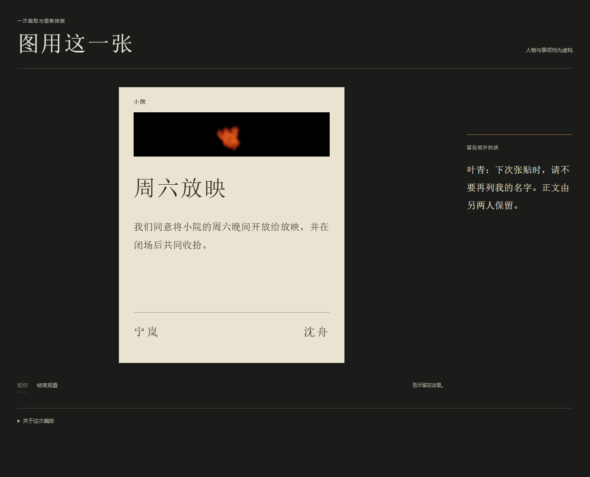

# 《图用这一张》

一张包含三人姓名的处理画面，被裁成下一张放映告示的配图。旧图的三名退出画面，宁岚与沈舟重新署在正文下方；叶青的撤名请求始终留在纸外。

[作品页面](index.html)使用仓库内已有静帧，点击开始后呈示一次14秒的裁取与排版，可暂停或结束。它不是重新燃烧、现实张贴或观众实验。人物与事项均为虚构。原A25作品保留原样。

[事先选择](../a31-next-posting-choice/CREATOR_CHOICE.md) → [有限制作约定](BRIEF.md) → [作品规则](WORK_SPEC.md) → [真实过程与七图](PROCESS.md) → [完整检查记录](inspection-01/result.json)。

2026-10-31完成一次呈示检查：18.3429543秒，7PNG共524083字节。[创作者反思](CREATOR_REFLECTION.md)、[原固定评审](../../../validation/art-a32-material-review-fixed.md)与[另一原评审](../../../validation/art-a32-material-review-second.md)支持一次固定材料的完整论述。按[写作范围](PAPER_BRIEF.md)完成的[新稿](PAPER_DRAFT.md)和[主张—证据映射](CLAIM_EVIDENCE.md)随后由同两位评审独立正式复评：[固定评审3/6](../../../validation/art-a32-review-round-01.md)、[另一评审4/6](../../../validation/art-a32-second-review-round-01.md)，准备度均7/10、置信度均3/5。没有新增制作或运行，两者的材料阶段支持不等于正式接收。

两位都承认实际图像用途与署名组织的变化，分歧在于它是否已超出普通裁图而具有足够艺术分量。[作者回应](RESPONSE_AND_DECISION.md)没有核心事实反驳或新证据，保留自己的正面解释，并封存此配置的投稿核心；root接受这个有限收束，不继续为追分润稿、补录或改参数。作品、初稿、映射和两份意见完整保留，不平均或抹平分歧。

材料资格与20项行为检查通过都不等于Art Papers贡献成立；原A25评分4/6和3/6、A26两份3/6均不因新小样改变，目标5/6仍未达到。艺术线继续，[A33](../a33-iteration-as-material/BRIEF.md)只判断真实迭代记录能否支持一个新的具体创作选择，不自动重开本作或A26综合。
