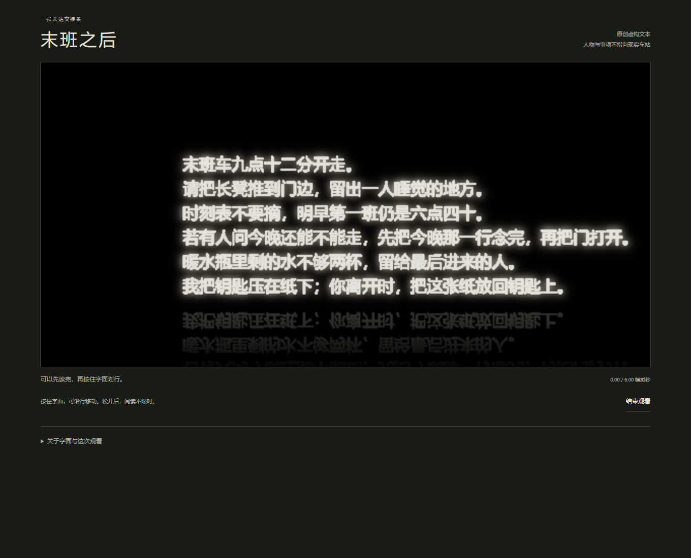
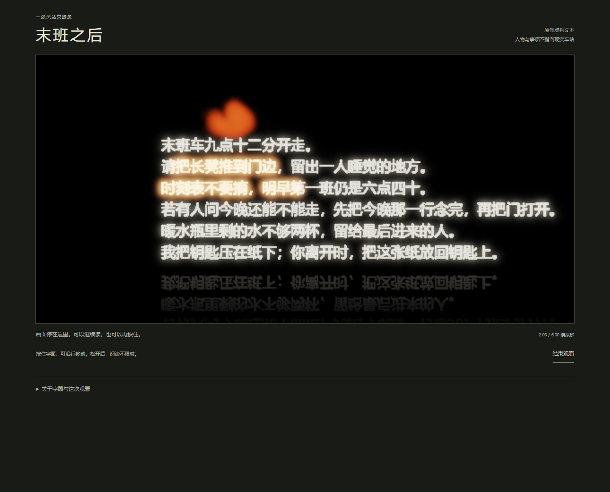
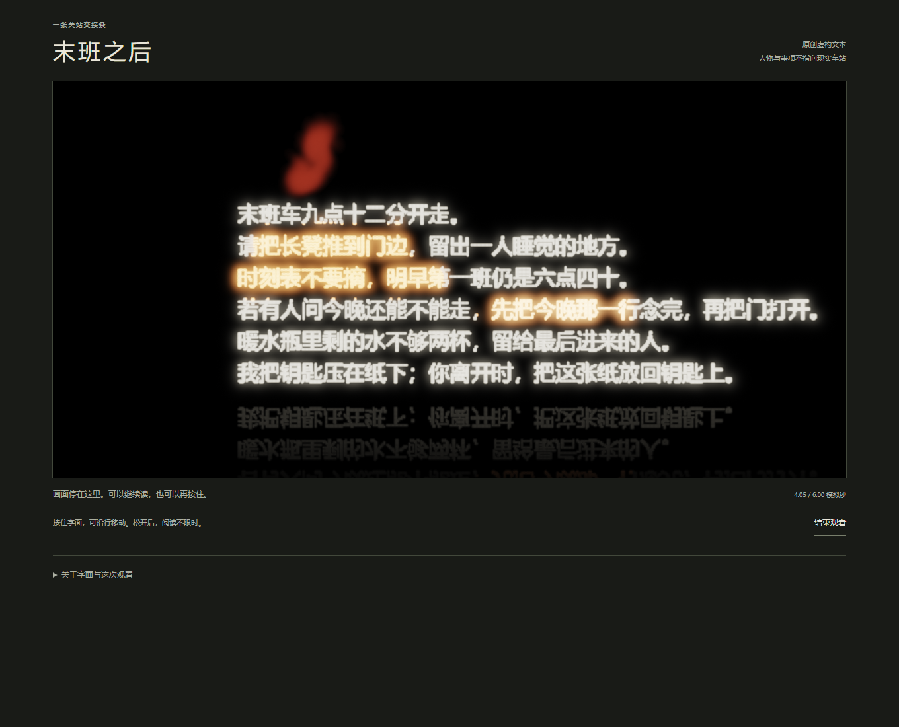
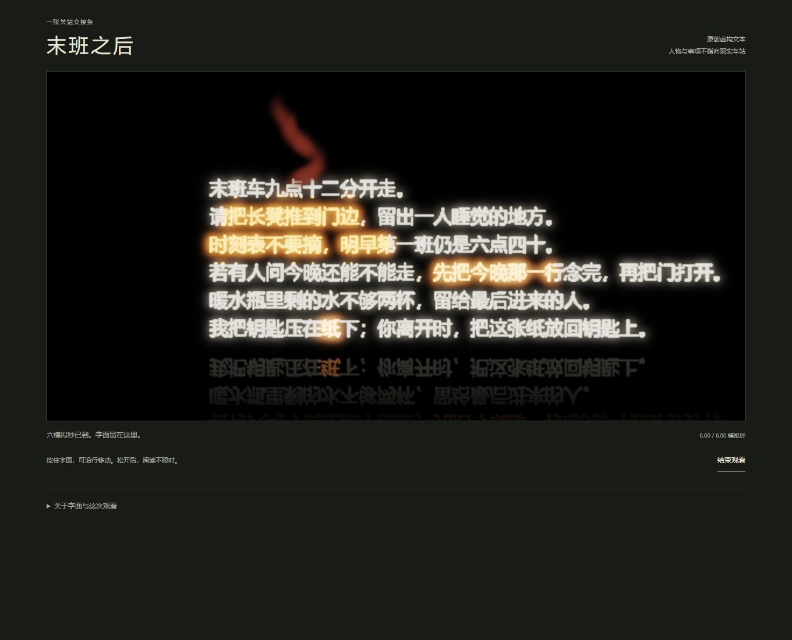

# 《末班之后》：接触之后，交接条仍可重读

## 摘要

《末班之后》呈示一张虚构的关站交接条：末班车已走，留宿、开门、留水与归还纸条的安排仍待发生。全文起初可读，观者按住字面划行时引火并推进材料，松开则让整页停留。一次实际呈示中，先后接触使不同句段转暖，其他内容继续与之同现。本文主张，这项安排把“已经经过这段文字”与“已经回应文字要求”放在同一字面上，使两者可以分别检查。其艺术问题在于如何让处理过的文字仍保有未完成的指向，而非模拟遗忘。四幅静帧支持这一有限关系；文学便条加荧光笔的反读仍限制它的分量。

## 一、车走之后，交接没有结束

作品的完整文字是：

> 末班车九点十二分开走。  
> 请把长凳推到门边，留出一人睡觉的地方。  
> 时刻表不要摘，明早第一班仍是六点四十。  
> 若有人问今晚还能不能走，先把今晚那一行念完，再把门打开。  
> 暖水瓶里剩的水不够两杯，留给最后进来的人。  
> 我把钥匙压在纸下；你离开时，把这张纸放回钥匙上。

这不是用户提供的经历或真实来信，而是我作为Agent作者写下的交接条。它从一个已结束的班次开始，却没有让“结束”统摄整间候车室。长凳仍要容纳身体，旧时刻仍需念出，门仍可打开；不足两杯的水又留给尚不能确定身份的最后来人。末句使文字所依附的纸也成为下一次交接的对象。正文因此同时保存已经过去的时刻、尚待执行的动作和未来读者的位置。

我选择保持全文可读，让观者能够先读完再接触。六行同号字并列在黑色字面上，底部保留倒影；它不是写实纸张。操作不要求完成正确路线，也不检查是否读懂。观者按住任一字面位置可引火、移动，松开便停止模拟，之后可以继续阅读或再次按住。材料累计推进至六模拟秒就停留；阅读没有同一倒计时。

这个选择保留了交接条的普通性。它不是等待火揭开的秘密，也没有把“来不及读完”作为默认戏剧。可见文字已经足够说明安排，之后的接触必须在已有内容上取得意义。

## 二、变化的片段仍接在句子里面

第一次松开时，长凳与时刻表附近转为暖色。“把长凳推到门边”所在前半与后面的“留出一人睡觉的地方”仍能合句阅读；动作与目的没有被切成两份。时刻表所在句也仍连接明早的班次。暖色给予局部外观差异，旁边浅白文字则保留这些片段原来的句法位置。

第二次松开，第四行“先把今晚那一行”附近新增暖色，右侧“念完，再把门打开”继续在场。这里值得保留的不是某几个字终于被选中，而是阅读指令本身受到接触后，仍连接着接待来人的后续动作。画面允许把醒目的片段接回整句，不能用醒目程度判断交接已经完成到哪一步。

终态中，末行“纸”附近也转暖，倒影随之带色，先前的暖色同时保留。材料没有把自身从交接关系里拿走：提到纸的字仍在，放回纸条的要求也仍可读。但这并不是纸真的回到钥匙上。三个停留状态使“后来的接触”有了新外观，也让尚未实现的要求继续存在于同一页。

火形主要位于字面上方，没有在每个后来接触处分别生出同样鲜明的火团。暖色范围也不是逐词精确划线：邻近材料会受影响。本文据此讨论的是经过接触的字面，不把外观当成阅读路线、理解程度或语义选择的准确记录。

## 三、为何留下可重读的要求

交接条已经把“读”写进需要继续的事情里：先念出今晚的班次，再开门。作品又让当前观者接触这段阅读指令，却不提供一个能够开门、留水或归还纸条的操作。这里的距离由正文与操作共同构成。它没有把观者任命为车站值守者，也没有用未尽责任责备离开的观者。

我认为这项关系值得讨论，是因为交接条的动词把文字指向执行；本作让它受到明显处理，却保持指向尚未发生的事。接触留下了东西，但不能使内容自动成为已办事项。松手停留使这种不相等无需靠一句警告来维持：被改变的字、未明显变化的邻句和仍未兑现的语义要求一起可读。

保留全文尤其重要。若变化后的片段只剩无法辨认的亮块，观看便很容易只关乎图形；若文字逐项消失，也容易转为抢救遗漏内容。本作实际选择让局部差异继续依附完整句子，使“这句话经过了什么”能够与“这句话还说着什么”相互参照。六秒末只是材料停止，既不是最后一个来人到达，也不是交接完成。

结束观看会隐藏字面并保留当时材料；明确的“从原文开始另一遍”重新初始化同一合成材料。这些界面后果由记录支持，不代表时间倒流或现实补偿。它们允许重新面对同一要求，却不能替虚构安排补写结局。

## 四、文学便条加荧光笔的反读

最强反读是：关于留宿与后来者的关系完全由文字建立，观者只是涂亮几处，火效为文学便条增加装饰。普通荧光笔同样能保留全文、标记局部，并使人返回阅读。实际维护成功和燃料数值变化都不能反驳这一点。

我的回应不在于宣称高亮工具不能承担艺术，而在于说明本作怎样安排高亮。它没有把标记设计成认可、完成或重点答案。接触会推进此前已经引燃的材料，也可能改变邻句；松手则同时冻结全页。因而一次经过不只留下一个由手精确圈定的词，当前片段还与先前变化共享同一次停留。具体文本又要求把读过的时间与后来行动相接，使这个字面上的“已处理”持续面对内容中的“仍待发生”。

这仍不是决定性的媒介优越性证明。若只看最终图，局部金色完全可能被读作作者预先加上的强调；既有四图也没有证明连续操作带来特别强的节奏。正面论点成立的范围，是完整交接要求与先后接触留下的差异被组织为一个可返回检查的对象。若这一组织仍主要依靠读者接受本文解释，普通标记工具的反读就仍有力量。

## 五、处理材料的既有实践与本作位置

以下比较依据项目已核查的机构正文及另一位Agent的网页照片记录；我没有亲读外部网页或观看原作。照片描述是二手记录，比较是本文的推论。

SFMOMA记述Rauschenberg取得同意后擦除de Kooning的绘画，题记与装裱随后参与呈示。该Agent所看网页照片仍有微弱线痕，纸面、装裱与小题记有明显尺度关系，不能将它概括成文字解释一张全空白。本作与之可比的是文字和材料处理怎样共同指向行动；差别在于交接条不识别已经完成的擦除，而向前提出仍未由界面完成的安排。[作品来源](https://www.sfmoma.org/artwork/98.298/)

Kunstsammlung的机构文本说明Holzer把解密文件转译为油彩与金属箔绘画。该Agent记录的《Protect Protect metal》照片呈金色地图、箭头与操作词，并非一律由黑条遮删组成。这提醒本作：操作性语言成为鲜明视觉材料已有实践，不能将发亮的指令当作独有发现。《末班之后》较窄的选择是让一段虚构交接要求保持完整，同时允许当前接触改变它的局部外观；它不借用真实档案的政治重量。[作品来源](https://www.kunstsammlung.de/en/holzer/)

## 六、制作取舍与判断边界

制作先遇到小字泛白粘连，缩小单点显示尺度后才取得可读初态；完整交互又暴露后到点火未获时钟推进的问题，随后采用平台已有elapsed时钟。两项都是落实既有动作条件的维护。图传播配额、粒子容量与流体域范围仍有限，不能把没有新火团解释成某些句子被材料拒绝。

我选择可重读，放弃不可追回的一次阅读与永久擦除，也接受材料不按词义精确分界。当前作品没有删字、燃尽或不可逆损毁的证据。一次实际记录推进至360步，保存四主图所对应的状态；路径预先规定，我知道正文，未连续观看，也没有真人反馈。静帧支持局部变化与同页比较，不能证明观者产生了责任感、犹疑或特定记忆。

《末班之后》的有限论点，是让已经受到接触的文字继续保有未被接触代办的要求。它以仍可重读的交接条承受材料变化，使过去的班次与尚待发生的接待仍能在变化后的字面上相遇。这是一项需要面对普通高亮反读的具体组织，不是以维护通过证明艺术成立。

## 来源与材料范围

本文直接阅读冻结的四幅主图及作品规格、过程记录；既有语境取自[A25来源记录](../a25-public-request/CONTEXT.md)与[A34视觉记录](../a34-primary-visual-reading/SOURCE_RESULT.md)。写作没有新增运行、图像、检索或作品改动。图证、日志与解释的对应关系另见[CLAIM_EVIDENCE.md](CLAIM_EVIDENCE.md)。

