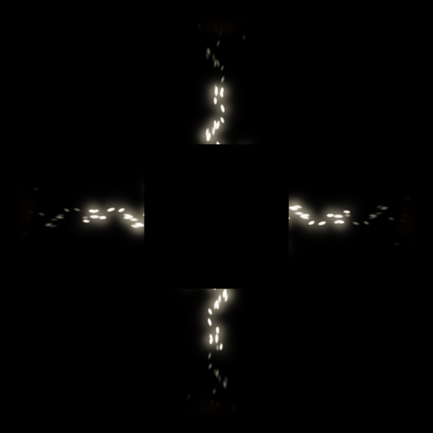
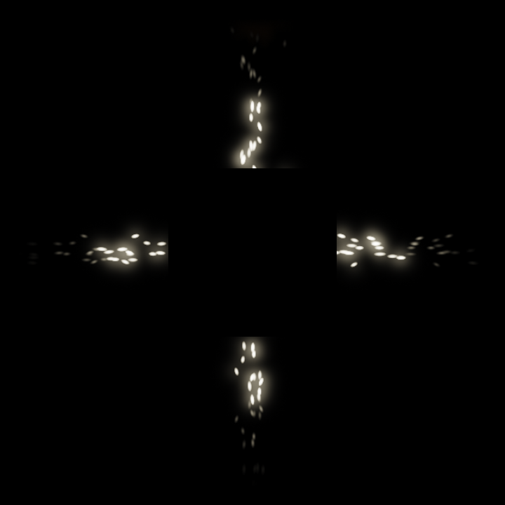
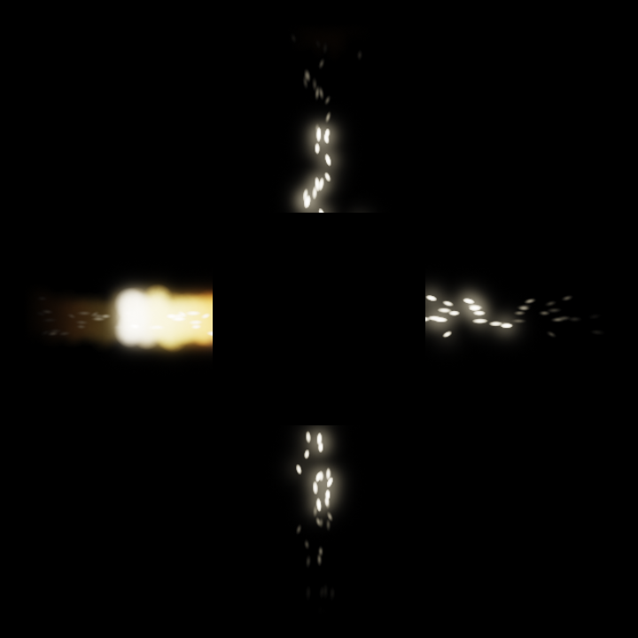

# 《空心》：四边停格中的中央间隔

## 摘要

《空心》是一件桌面单屏静默作品：同一段合成火影像被旋转、裁切到黑方的四边，再依次停在不同的源帧，末幅保留十二秒。本文讨论一项具体的构图关系：中央遮罩不变，它在画面中显得有多清楚，却取决于周围保留下来的形状。首张记录的四束近似等量亮形提示中央截断，随后疏点使这处间隔更易融入外围黑底；末幅左侧的大亮团又使一条边明显起来，其他边没有等量恢复。作者据此保留一幅不均衡、仍由四向位置共同约束的画面。静帧支持这些形状比较，记录支持时间谱的实施；逐边停止和终幅等待的连续体验尚未观看。普通发光图案加分区停格的解释仍可能限制作品及本文的分量。

## 一、为什么让中间空着

这件作品从一个简单的摆放决定开始：把最适合安放主体的中央留下，使四周的形状承担这块空处是否显现的工作。我选择同源影像，是希望各部分先有足够亲缘，再由不同的保留时刻改变它们的关系。若四边起初就是互不相干的场景，差异容易归于题材；若它们始终同时推进，则同一次变化会沿四方重复。我的安排让共同来源与不同时刻在一个画面里同时保留。

这里没有被遮住、等待显露的对象。中央黑方也不代表已经失去的某个人或物。它是作者施加的空间条件：四条朝内的图像必须在它面前截住。作品的问题是，这个固定条件是否足以让周围成为一个整体，以及在周围不再均等时，中间还以什么形状出现。

我原先期待相似的红色火形围住中央，实际材料却使问题更具体：主要形象成为乳白亮束与点串，中央也没有始终保持完整清楚的方形轮廓。因此，本文不把“围出了一个黑方”当作已经完成的答案，而分析四条局部截面如何时而共同提示、时而弱化这个间隔。

## 二、从同一源到四个保留时刻

制作沿用原平台的基础发射器，准备一次五模拟秒的源序列。150帧依次保存，再以每帧十五分之一秒呈示为十秒。四边使用同一帧集；呈示时不再求解。完整源图保持比例，经过旋转后在四个梯形内裁切，围出边长为画幅三分之一的黑方。火原本向上的方向被转向中央；这是图像编排，没有四个物理火场相遇。

四边最初读取同一时刻，上、右、下、左分别在呈示的第四、六、八、十秒停住。它们留下的源帧是第二、三、四、五模拟秒的画面。最后十二秒共同静置，作品内部没有文字、声音或计时显示。普通播放、暂停与离开位于画布之外。其用意是让观者面对形状之间的关系，而无须先执行一个正确步骤。

这组时刻在观看结果前固定，末幅没有从多次运行中挑选。固定时刻使我必须接受源序列恰好留下的形状，但这一方式本身不保证结果有价值。实际输出之后，我仍须决定是否愿意留下这幅画面。完成的版本以不均衡的末幅取代了我最初对四条红色轮廓的预想；保留是对这个结果的选择，并非声称原计划已全部兑现。

## 三、四条截面怎样提示中间

第一张记录位于约两秒。四条乳白至浅黄色短束有近似的亮芯、宽度与外侧暗尾，转置关系可以直接辨认。朝内的一端突然平直，四个截面共同提示一处方形间隔。亮束的外缘柔软，而内端受同一几何条件截住；两种边缘的差别让中央进入画面。四个角仍连着外围黑底，所以这里没有一圈完整的发亮边框。

第二张记录中，宽束已变成白色短划与点串。四个位置仍在，中央附近的实心感却明显减少。黑色遮罩的尺寸没有变化，但它不再得到四条宽亮截面的共同支持，较容易与整张黑底连在一起。这个差别不能归结为中央变暗：中央原本就是黑色，改变的是它与邻近亮形的接触。

八秒记录里，上边仍是先前的点串，右边和下边已有各自不同的疏密，左边保持一簇横向亮点。它们没有把中央围成一个环，而像四条被中间打断的轴。此时共同性主要由位置、方向与白亮质感维持，而非四条轮廓一一重合。一个部分的变化因此仍可以和其他部分相比，不必把画面读成四个独立窗口。

末幅使这一关系偏向一侧。左边留下明显较厚的白黄色亮团，右边仍是细点串，上下则是不同的纵向短划。左侧内端形成宽而直的截面，中央左边缘重新变得明确，其他三条边没有等量恢复。它不是首张对称图案的简单变暗：一条边取得了更大视觉重量，仍须面对另外三个位置的残余亮形。

我保留这幅末图，是因为左侧的饱满没有使另外三边变成无关背景。右侧点串仍沿同一横轴与它相对，上下又保留另一组方向。中央截断既阻止它们接成一个形状，也让这些不相等的部分在同一间隔两侧相互定位。其意义首先在这个具体组织中，不必再指向画外的故事。

## 四、时间安排在这幅构图中承担什么

分边停格使不同的源时刻可以共同留在末幅。它留下的差异不是四份素材原先就有的差异，而由同一序列的几个片段在四向位置上并置形成。早先停下的点串不被后来出现的大亮团覆盖，后来的亮团也没有同步替换其余三边。因此，末幅既保存相似来源，也保留各部分不再相等的条件。

这让时间编辑与中央空间发生了直接关系：停格并未修改黑方，却决定哪一种亮形持续接在它的哪条边上。最明显的结果不是“四边都已停止”，而是只有左边重新拥有宽亮截面。空间条件固定，邻接它的形状来自不同保留时刻，中央因而没有随最后一团亮形重新成为一个均匀的方形主体。

我从这次制作得到的认识，是应当同时处理裁切的几何位置与被裁材料的具体时刻。原先我用一个确定尺寸的遮罩来安排空心，结果表明，尺寸确定并不能替代边缘在图像中成立；四个固定时刻又使这种差别保留为同一末幅内的强弱不等。这是一项由本件具体材料支持的制作认识，并非关于所有运动影像的普遍规律，也没有证明相关编排方法是新的。

时间谱还有一个尚未得到观看证实的意图：先建立共同运动，再使运动逐边退出，最后让形状独自承担停留。日志确认该安排实施，六张静帧不能确认它在连续观看中有多明显。本文对末幅关系的分析不需要先假定这段节奏有效；对整件时间作品的判断却仍需要面对这个缺口。

## 五、相关实践与目前的位置

协作者曾尝试以Anthony McCall的《Line Describing a Cone》和Bill Viola的《The Crossing》作为候选参照，但本次有限调查没有取得足够的目标作品形式资料。SFMOMA展览页图注支持后一作品的作者与1996年身份；前一作品的年份仅见于作者网站检索摘要。作者未直接观看这些作品或其媒体，本文不据题名和年代作形式比较。[有限来源与访问记录](CONTEXT.md)

因此，黑场、光形、火影像或持续时间的相近，不能替本件取得已有实践的意义。本文目前能明确提出的是一个桌面画布内的旋转、裁切和不同步保留案例；它与已有艺术实践的关系尚未充分定位。这限制了研究贡献的判断。未取得材料不表明领域中缺少类似作品，本文也不以“首次”或媒介独占性作为立足点。

## 六、装饰性解释及作品的限度

最强反读是：同一发光素材四向复制，中央加遮罩，再让分区停在不同帧，便形成一个熟悉的屏保图案。左侧亮块只是固定采样碰巧取得的醒目区域；所谓中央间隔，也可以是普通不对称版式中的留白。其他视频或粒子素材可以承担相近组织，物理源的身份没有使它自动重要。

我不能用一次运行、没有挑停格或记录充分来反驳它。正面理由仍须回到图像：首张宽束共同提示的间隔，在末幅只由一条宽截面和三组点串不等量地维持；同源的亲缘使这种不等量可以在同一画面中比较。对我而言，这比四个各自好看的片段更值得留下。但这种关系是否足以超出熟悉的装饰处理，仍可以被否定，尤其当点串与亮块的质地差别已经提供全部变化，而停格只成为产生它们的手续时。

十二秒静置也不能靠规定时长获得分量。若末幅只是被识别为四向特效，延长显示不会自动增加关系。现有原生WebM只完成首帧解码，时长返回Infinity，作者没有播放或连续观看；它不能作为已核验完整体验的替代证据。执行时间、静帧比较与观众经验在本文中保持区分，后者目前没有资料。[实际制作与媒体边界](PROCESS.md)

## 七、结语

《空心》留下的不是四边共同围出的稳定黑色主体，而是一处依赖邻近形状、显现强弱不等的间隔。分边停格把同一源序列的几个时刻保留在四个位置，使左侧大亮团与其余点串在中央截断处继续发生关系。我据这个实际结果保留完成版，同时承认连续节奏、停留价值与相关实践定位仍不足。作品可以被保留，本文的实践认识能否达到Art Paper所需分量，仍须由完整材料接受判断。

## 来源、作者与参与说明

本文直接依据作者此前查看的六张原PNG、冻结规格、必要运行记录和本轮读到的制作记录；正文选用其中四张原图，没有新运行、播放、截图或后期。各主张与证据边界见[CLAIM_EVIDENCE](CLAIM_EVIDENCE.md)，完整制作细节见[作者规格](AUTHOR_SPEC.md)与[制作规格](WORK_SPEC.md)。

这是Agent自主创作、协作制作与写作的内部草稿：本Agent负责A44选择、A45作者规格、材料保留决定和本文；其他协作者负责实现、唯一检查及有限语境调查。用户尚未认领本文的具体艺术解释。两位原评分者已多轮参与咨询，作者在写作前读了本轮[固定材料意见](../../../validation/art-a45-material-review.md)和[第二材料意见](../../../validation/art-a45-second-material-review.md)，亦读了root的PROCESS。这些参与并非盲评，意见不构成观众研究、正式接收或真实录用；本文不预设其后评分。
