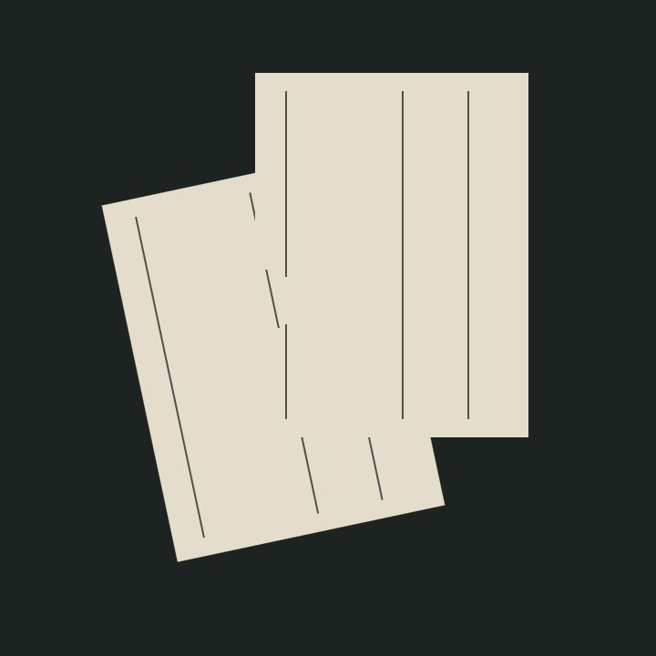
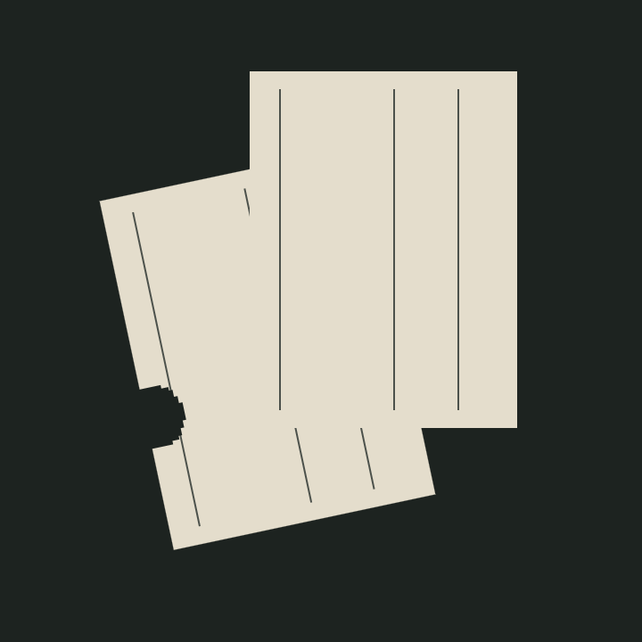

# 两张错层纸片：A48材料资格

唯一运行已完成，得到以下三张原720×720图。前片的159格材料变化在动作后交给后片，几何和线条位置保持。动作前的形状主要通过线条显露，动作后的联合外缘缺口更明显。尚未取得作者保留或新的正式Art Papers评分。

[实际过程与限制](PROCESS.md) · [作者事前规格](AUTHOR_SPEC.md) · [实现边界](WORK_SPEC.md) · [材料阅读合同](MATERIAL_REVIEW_BRIEF.md) · [证据摘要](SUMMARY.json)

画面是新二维格片呈现，材料来自原平台的固定命中及燃烧时钟；没有流体粒子、原Gaussian火焰图、真实纸燃烧或真人反馈。此页不等同投稿核心成立。完整15MB原快照以无损SNAPSHOT.json.gz保存，避免直接提交大JSON。
