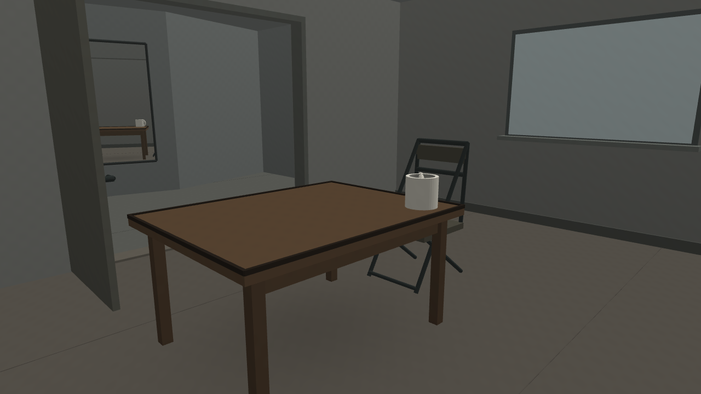
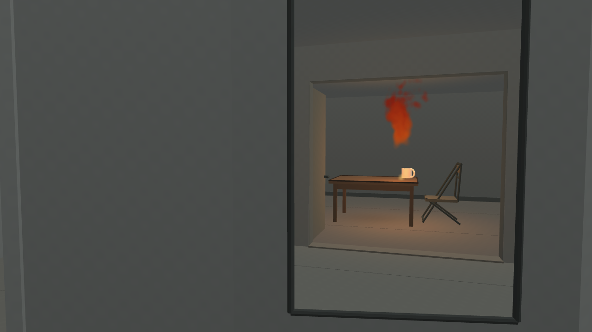
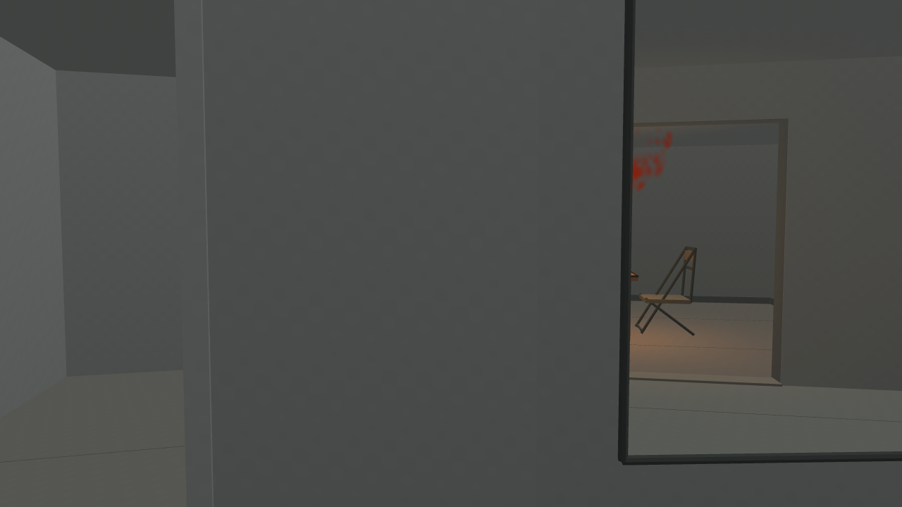

# 《背向房间》· A52

一件尚在制作的120秒合成单镜头作品。先认识房间，再在离开过程中从走廊镜面获得剩余视线。房间/镜面是普通网格与单次平面反射，火形来自原VortexGaussians确定性粒子数据的艺术化映射；家具没有物理燃毁。用户没有提供私人住户故事或观众反馈。

[作者提案](../a51-independent-artistic-proposal/CREATOR_PROPOSAL.md) · [空间实现](SPATIAL_PLAN.md) · [火源说明](FIRE_SOURCE.md) · [首轮实际记录](PROCESS_DRAFT01.md)

首轮草稿已取得12张1280×720原图，总耗时7.7084993秒、资源全部关闭。原作者正在独立作形式取舍。完整MP4尚未制作，当前没有连续观看或新论文分数。原图位于draft-01，完整小型执行记录见[result.json](draft-01/result.json)。

素材为本项目合成，无第三方照片、私人扫描或真实火灾。技术有效性、原作者是否保留作品和Art Papers论文分量分别判断。
