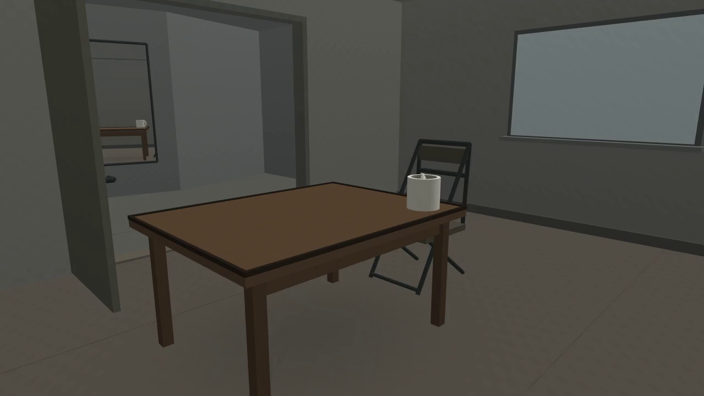
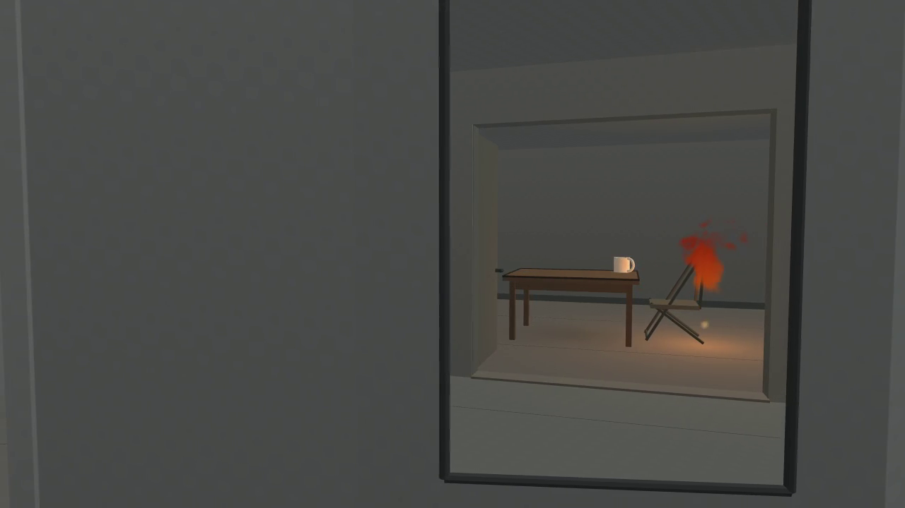
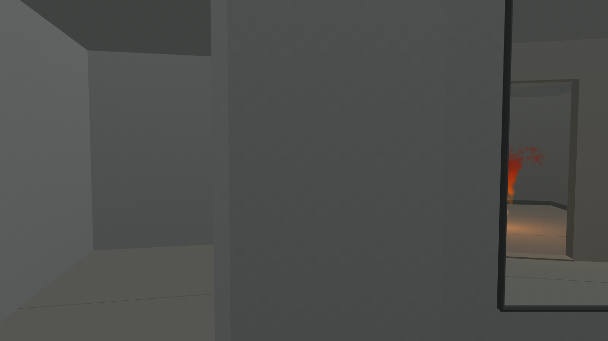

# 《背向房间》· A52

一件120秒、无声的合成单镜头作品。先认识房间，再在离开过程中从走廊镜面获得剩余视线。房间/镜面是普通网格与单次平面反射，火形来自原VortexGaussians确定性粒子数据的艺术化映射；家具没有物理燃毁。用户没有提供私人住户故事或观众反馈。

[观看完整影片](film-01/room-facing-away.mp4) · [作者提案](../a51-independent-artistic-proposal/CREATOR_PROPOSAL.md) · [初始空间](SPATIAL_PLAN.md) · [唯一空间修订](REVISION_PLAN.md) · [火源说明](FIRE_SOURCE.md) · [媒体与观看记录](MEDIA_RECORD.md)

原作者读完两轮各12张原图后保留了唯一修订版：60—84秒火形与椅背重叠，94秒家具退出后仍有一段火形；桌沿遮挡未显著成立。原草稿均保留，见[首轮](PROCESS_DRAFT01.md)、[修订轮](PROCESS_DRAFT02.md)与[作者取舍](CREATOR_REVISION_RESPONSE.md)。

完整H264 MP4为1280×720、24fps、120秒、5,138,756字节。原制作在编码完成后的元数据JSON解析失败；失败记录保持。对同一现存文件的独立检查确认全部2880帧可解码，并提取七张编码后关键帧，没有重新制作影片。技术有效性已确认；正常速度连续阅读及新论文分数仍未取得。

素材为本项目合成，无第三方照片、私人扫描或真实火灾。技术有效性、原作者是否保留作品和Art Papers论文分量分别判断。
