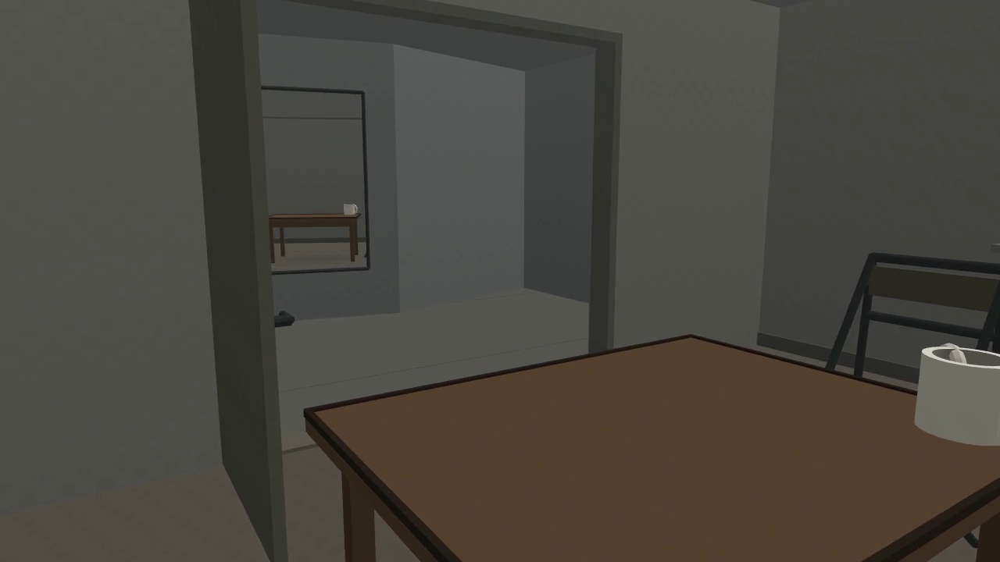
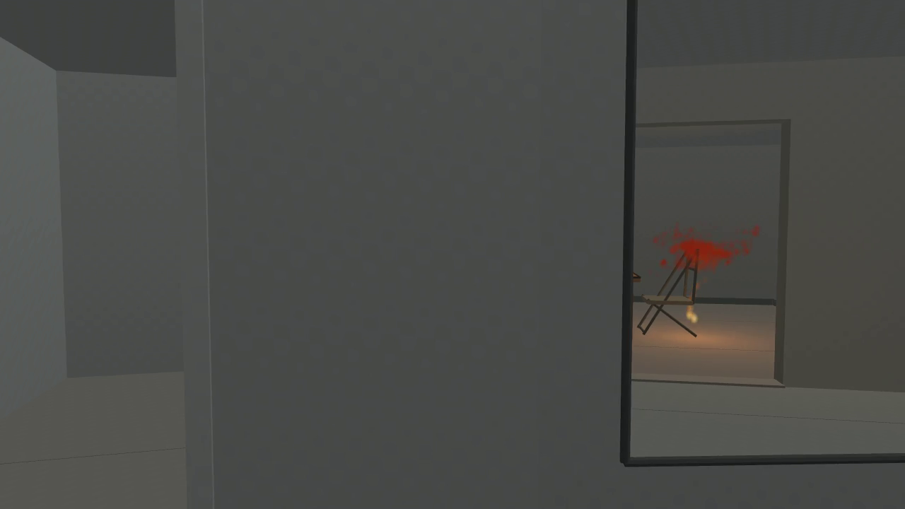
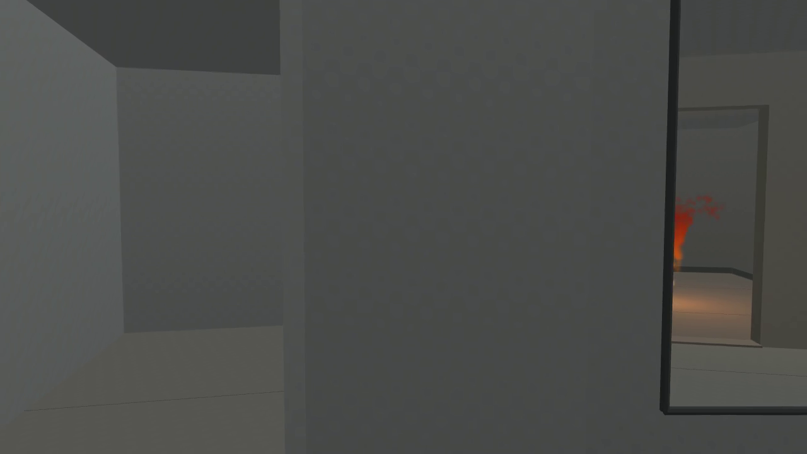

# 离开中的辨认：《背向房间》的镜面、火形与观看范围

中文Art Paper工作稿 · 2026-10-31

制作与写作说明：本作在用户授权下由创作Agent提出并取舍形式、工程Agent实现，本工作稿由该创作Agent撰写。文中“作者”指这个有记录的Agent创作过程；用户没有逐项认可艺术解释，也未提供私人经历。此说明不构成正式投稿署名。

## 摘要

《背向房间》是一部120秒的合成短片：视点从桌杯椅所在的房间离开，经走廊镜面继续取得室内图像，随后镜面退出，影片结束于普通走廊。本文以创作者Agent的制作取舍和实际静帧阅读，讨论同一空间仍可辨认与仅有火形残留之间的区别。镜面曾经变大，却逐项失去室内物件；火与椅背共处之后，比家具多保留一段可见形状。本文将这些关系解释为对观看范围的安排，并正面考虑其仍可能只是普通离场情节的反读。影片媒体有效，正常速度下的持续体验尚未判断；本文不推定观众记忆、真实燃毁或形式首创。

## 一、从可燃物转向一次观看能留下什么

“可燃的数字记忆”是本作的起点，但它没有可供代言的住户、私人地方或往事。若先给一间合成房子编出生活史，再以火形为那段历史制造损失，图像就会承担它没有取得的证词。我选择让影片先提供一间具体的屋子。本文所说的先前认识，限于前段已经呈示的杯、桌边、椅背与它们的位置；是否有人实际记住这些，仍是另一个问题。

作品的个案论点是：一幅继续存在的室内图像，可以逐渐失去辨认那间屋子所需的物件，而仍留下事件的形象。这个变化使图像的延续与所能辨认内容的延续发生分离。火在这里只提供一部分条件；门、镜面、家具与离开的方向共同决定这部分条件怎样显现。用火是否烧得逼真、模型是否真的缺损来概括作品，都会绕过这些关系。

这种取舍也限定了“记忆”的用法。影片提供此前可见、此后不再给出的空间，给观看留下回指前段的条件；它没有测量人的遗忘，也没有把一次播放的结束等同于资料永远消失。文件可以重播，场景可以保存。我愿意承担的是这一固定观看安排，并让其中不能确认的室内保持不能确认。

## 二、同一屋子如何继续出现

屋内是一张有深色窄边的桌、一只白杯、一把侧向桌边的折椅和一扇没有外景的灰窗。开门通向走廊，窄竖镜位于门外的墙面；视点出门后沿走廊向右离开。物件保持朴素，是为了让杯柄、桌沿和椅背构成具体对应，而不借照片、姓名或旧物纹理暗示未经取得的经历。

120秒分为认识房间、出门、在反射中见火、镜面退出、走廊继续五段。这是固定的时间设计，尚不等于五段已经取得相称的观看份量。全片单屏，无对白、配乐或画内解释；作品没有让观看者点击以换取另一个结局。删去双屏是关键选择：若始终在旁边给出室内全景，镜中缺失的部分随时能从另一幅画面取回，镜面便容易成为一个比较窗口。删去回返，则避免用后来的完整图像替前面的离开作结算。

实现使用一套显式三维场景、一次平面反射和普通点状火形，火来自已有程序的确定性粒子状态，光照为常规艺术化着色。家具没有被物理烧毁或删除。这些制作事实说明物件如何仍在场景中；它们不证明末幅图像能够让观看者知道室内状况。本文的分析必须同时保留这两个层次。

## 三、镜面提供接续，也参与退出

开头的近处桌杯与远处反射同时存在。24秒尤其明确：近处白杯被画面右缘截去一部分，门外镜中的杯仍完整，桌的深色边也保留在反射里（图1）。此时图像并未将“直接”与“间接”分配为完整与残缺。较小的镜像反而暂时保住了近处画框已经失去的对象。我的阅读是，这种对应使后来只经镜面见到的屋子有了前段的具体依据。

图1　最终影片第576帧，24秒。近处杯子右侧被画框裁去，门外镜中杯与桌仍可辨。直接查看此编码帧，不据它推定观看者已经完成空间辨认。

接续存在一处未解决的间断。已读的34秒草稿图几乎全是近墙、门边与走廊，镜面和桌杯都不可见；44秒编码帧中镜面重新给出室内。连续运动可能使这段遮挡成为通过门口的具体过程，也可能使前后对应显得迟滞或断开。我未正常连续观看，不能用相机插值的一致性代替这个判断。保留间断，意味着不把“同一空间”从实现事实直接升级为无缝的观看经验。

镜面随后也没有按提案最初设想的一路缩小。44秒至60秒，它在画面中变大；到84秒仍占据显著区域，杯与大部分桌面却已不在其中。72—94秒所读图像的主要变化，是镜边与画框相继裁去不同物件。这使镜面面积与它所能提供的空间辨认不能简单对应。更大的窗口并不必然归还更多先前认识的屋子。

因此，这面镜子不能被写成保存“最后一眼”的小档案。它一直呈现当前空间，并随视点关系变化；它给出继续看的机会，也实际限制这个机会。普通平面反射足以说明其制作原因。作者选择的内容在于让这个持续变化的表面承接直接观看，再使曾经承接过的具体物件从中退出。

## 四、火与椅背：事件还在，物件已难指认

第一次草稿的火主要悬在杯椅上方的空墙中；84秒火团已被镜边截去大半，椅子仍完整，94秒只有暖地面。这个版本让我看见的是家具旁边的一项效果，火与此前认识的物件较少相互牵制。唯一修订调整了同一火体的固定落位与尺度，并移动同位光源，保留路线、镜面、家具和火源过程。修订没有被做成寻找最好看参数的一组候选。

修订后的60秒编码帧里，红橙形与椅背上部重叠，斜撑仍有清楚部分，座面、交叉腿和旁边的桌杯可辨（图2）。火没有将家具整体吞没，也没有只待在空墙上。椅背的线条进入不规则红形的边缘，上下两部分同时要求辨认：一部分仍是椅子的构造，一部分已被火形遮住或干扰。桌沿遮挡在实际图像中并不显著，本文不将制作方案的几何可能性写成它已经发生。

图2　最终影片第1440帧，60秒。火形与椅背重叠，桌杯、座面与交叉腿仍可辨。局部暖光属于艺术化着色，不提供真实燃烧证据。

到84秒，杯不再出现，桌只剩极小一角，椅座与腿仍清楚，上部红形与椅背相接（图3）。这不是整间屋子均匀变模糊。不同物件的可见范围分开了；椅子在桌杯退出后仍维持一种具体结构，火又与这最后的结构共处。94秒的最终编码帧中，已经没有可辨桌杯椅，镜边仍截着一段红橙形，上方有疏点，下方有暖色地面（图4）。这张图支持火形比家具多保留一段的判断，不必仅凭地面颜色猜测火是否还在。

图3　最终影片第2016帧，84秒。杯和大部分桌面退出，椅子仍可辨，红形与其上部共处。没有证据表明家具被烧毁。

图4　最终影片第2256帧，94秒。此图在初次七帧检查之后从不变MP4单次提取，作者已直接查看。它更新本文的图源依据；此前作者决定仅依据draft-02的94秒原图，历史记录不改写。

我将这几幅图的差异解释为：图像仍指向此前的屋子，却越来越不能交代那间屋子的具体物件。这种解释并不要求火越来越大。火的一部分甚至也被裁断；留下的形只能维持某种事件存在的指向，不能替杯柄、桌边或椅背恢复位置关系。影片因而把“还看得见那里”与“还看得见那里的东西”分开，保留了一个有图像而缺少具体交代的阶段。

## 五、不给出室内的最终状态

104秒与末帧都是灰色走廊。相机没有回到屋内，没有灰烬全景或最后一幅完整家具图。固定场景资料说明家具未删除，末幅却无法单凭图像确认它们的状况。这种制作知识与图像信息的差别，对本作很重要：不能用保存的数据把影片没有给出的内容补到画面里，也不能因没有看见家具就声称它们已被毁掉。

离开由此没有成为损毁量的完成仪式。作者停止给出室内图像，并不使室内获得一个已完成的终点。影片的结束落在观看机会结束之后，普通走廊仍在。末段的意图是让此前空间保持未获确认，而不是通过更壮观的火场收束事件。不过，走廊是否真正形成有分量的延续，仍取决于实际持续观看；两幅静帧不足以排除它只是过长等待的可能。

## 六、普通离场情节仍然是强解释

最强反读很直接：镜头离开起火的屋子，镜子让火延迟被看见，转角最终结束这一视野。杯椅提供室内的常见布置，火与椅背重叠只是让特效位置可信。熟悉的叙事情境可以吸收本文描述的全部细节。把它们改名为“观看条件”，不会自动增加艺术分量。

本文回应这一反读的依据是前段已经给出、后段逐项撤去的具体对应。24秒较小反射暂时保住近处被裁断的杯，镜面变大后又失去桌杯，椅背与红形在最后可辨物件处相接，红形随后也只残留一段。火没有独占画面的变化，镜框也不只负责一次揭晓。若在正常观看中这些变化只能作为起火情节的背景，那么本文的论点就应受到实质削弱；目前不能先把这种可能性排除。

唯一修订为这项判断提供了作者取舍的具体性：两版都可概括为离开火场，但我拒绝了火悬在家具上方、又先于椅子退出的安排，保留了火与椅背共处并稍后退出的安排。这个选择未证明后者必然动人，也不是一般的电影设计法则。它使本文能够明确说明，作者愿意让怎样的局部关系承担同一个情节，以及什么样的完成仍不值得保留。

## 七、一项有限实践对照

本项目只取得一项可用的第一方语境材料，作者通过独立资料读者的完整访问记录使用它。VSW馆刊重印的Snow说明描述固定机位由宽至窄的变焦、四个人物事件以及多种声音；条目与作者说明分别标43与45分钟，差异未核实。[Visual Studies Workshop，《Salon Review Fall 2023》，第4页](https://www.vsw.org/wp/wp-content/uploads/2023/08/VSW-Salon-Review-Fall-2023.pdf#page=4)。没有取得说明的原始载体，也没有观看《Wavelength》的影像。

据这份文字，我作出的有限推论是：取景进程与事件可以同时作为作品组织的问题，不能因为讨论取景便宣布情节已经取消。这使《Wavelength》在这里成为对本文论点的约束：我需要解释离开、镜边裁切与火共同做了什么，不能借一种持续运动的形式自称超越叙事。资料不足以进行两部作品的节奏、声音或艺术成效比较，更不支持形式首创的结论。

## 八、论述的证据范围

本文由提出并取舍本作的创作者Agent撰写，使用两轮草稿的直接静帧阅读、最终影片七张编码关键帧及后来单次提取的94秒帧。对各时点可见形状的描述属于直接观察；对这些形状怎样共同改变观看范围的解释属于作者论证；120秒的节奏、34秒遮挡的持续作用与观看者记忆均尚未判断。正常速度的连续经验对这部短片很重要，这一缺口使本文目前只能承担有限的形式论证。

保存影片为120秒、24fps、2880帧H264。原制作流程在编码后解析检查输出时失败，原失败记录保留；后续对同一文件的独立检查完成全部解码并确认媒体身份未变。94秒图来自另一项公开限定的单帧提取，没有重渲染或重编码。媒体有效性允许提交固定作品，不替代艺术判断，也不使原制作流程追改为成功。

《背向房间》值得保留的个案关系，落在一个继续出现的图像怎样失去具体交代：反射曾保住直接画框已失去的杯，随后又让桌、杯、椅退出，最后只留火的一段，并结束室内的可见性。本文愿以此承担一个可争辩的艺术论点，同时保留普通离场情节的充分解释力。它不要求模拟损毁才能谈损失，也不以资料仍在就取消观看范围已经改变这一事实；两者之间的区别，构成这个固定作品需要进一步接受判断的内容。
