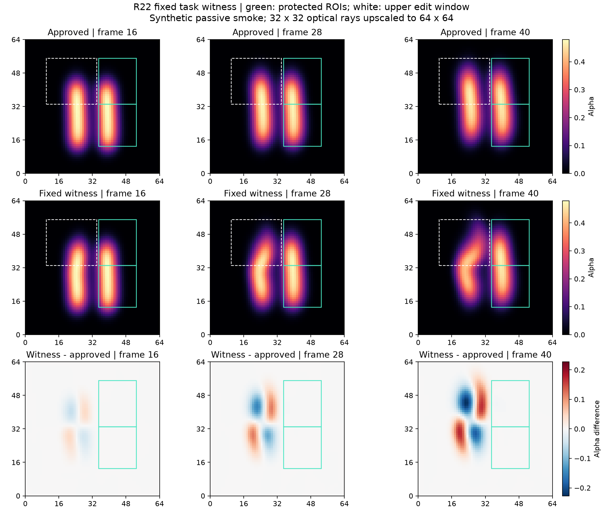

# Research evidence carried into this repository

R19–R22 leave a useful research platform, **not an established TOG contribution or a validated interactive fire editor**. This small directory preserves the decisions, including negative results, without requiring the original workstation or large experiment archives.

| Round | What was established | What remains unestablished |
|---|---|---|
| R19 | A concrete hypothesis: reuse a protected shot's control response across edits. | No numerical experiment, novelty proof, or cost benefit. |
| R20 | A fixed rank-16 response approximation passed local derivative screens in one small smoke scene. | Only E1/E2 were qualified editing tasks; no optimizer or reuse speedup was tested. |
| R21 | Ordinary full-space optimization completed both tasks in all three repeats; median two-task time **17.128 s**. | Protection penalties were inactive throughout logged closures. The historical **53.764 s** response build has no payback in this short session, even if subsequent work were free. No response-assisted candidate was run. |
| R22 | A fixed curl-derived control changed the left plume while preserving the right plume under the original gates. | Upper-region **rightward** shift reached only **1.4066 output pixels**, below the fixed 2-pixel requirement. No frame met all semantic conditions; no optimizer input pack or comparison was run. |

These are successive decisions in a shared development scene, not four independent demonstrations. Three R21 timing repeats are not three scenes. The R20 build cost is a historical measurement of that implementation, not an algorithmic lower bound or a measured candidate slowdown.

## Read the local evidence

- R20: [selected result fields](round20/summary.json), [scene and witnesses](round20/scene-and-witnesses.png), [task qualification](round20/task-qualification.png), [response structure](round20/structure-diagnostics.png).
- R21: [selected result fields](round21/summary.json), [cost and quality](round21/cost-and-quality.png), [editing results](round21/editing-results.png).
- R22: [selected result fields](round22/summary.json), [witness images](round22/witness-frames.png), [qualification curves](round22/qualification-metrics.png).
- [Machine-readable catalog](catalog.json): original report/manifest hashes, historical locations, included asset hashes, and provenance.
- [Integration review](INTEGRATION_REVIEW.md): tested CLI/page-shell behavior and its explicit limits; no new simulation or GPU experiment.



The JSON summaries are **new, derived reading extracts**, not byte-identical copies of original run summaries. The PNG files are byte-identical historical plots. Each original summary and copied plot was checked against its sealed manifest before inclusion. No simulation, optimization, derivative computation, rendering, or performance measurement was repeated to create this directory.

## Scope of the evidence

R20–R22 use a common **32³ periodic MAC passive-smoke model**, 40 steps, Float64, and 6,144 force controls. A fixed 20° orthographic camera uses 32² optical rays and upsamples alpha to 64². It has no combustion, buoyancy, obstacles, Gaussian renderer, or captured-scene editing. This evidence does not validate those capabilities in either current track.

R20's original finite-difference gate failed in two directions. A separate, explicitly post hoc smaller-step convergence check passed; both facts are retained. A response error near 21.6% is a derivative approximation diagnostic, not a 2% image error guarantee. E3/E4 were insufficiently exposed tasks, even though their derivative measurements were useful perturbation diagnostics.

R21's log records support the inactive-penalty observation; the independent check did not replay all intermediate optimization states. R21 final velocity/density arrays were not saved. R22 does save all 41 states, but its coarse curl is not divergence-free after the existing interpolation: projection changes the force by about 6.22%. Total density mass decreases by about 2.04%; small discrete divergence does not establish physical accuracy. Alpha centroids describe images, not material trajectories or human judgements of artistic success.

The independent checks were separate NumPy implementations within this research effort. They were not external peer review, new GPU runs, or independent timing measurements. Their check counts are record-verification coverage, **not research contributions**.

## What a clone contains—and what it does not

This directory is a portable reading bundle under 3 MB. All links above resolve inside the repository. `archivePath` strings in `catalog.json` identify paths **relative to a historical external experiment archive**. They are intentionally not Markdown links or repository paths. The full original reports, manifests, arrays, logs, failed launches, protocols, and audit scripts are not shipped here; a hash identifies a file but does not make it downloadable. No public archive URL is asserted.

Current executable track code and any separately bundled fixtures have their own provenance and tests. Running a new CLI or opening a browser page does not rerun or reproduce the archived R19–R22 experiments. For the older browser implementation's evidence boundaries, see [the existing research evidence status](../../research/EVIDENCE_STATUS.md).

To verify every included summary/PNG against the catalog using Python's standard library, run from this repository's root:

```sh
python -c "import hashlib,json,pathlib; p=pathlib.Path('tracks/evidence'); d=json.loads((p/'catalog.json').read_text(encoding='utf-8')); a=[x for r in d['rounds'] for x in r['repoAssets']]; assert all((p/x['path']).stat().st_size==x['bytes'] and hashlib.sha256((p/x['path']).read_bytes()).hexdigest()==x['sha256'] for x in a); print('Verified',len(a),'included assets')"
```

This checks the reading bundle's integrity. Reproducing the historical scientific conclusions requires the corresponding external archives and their recorded environments.
