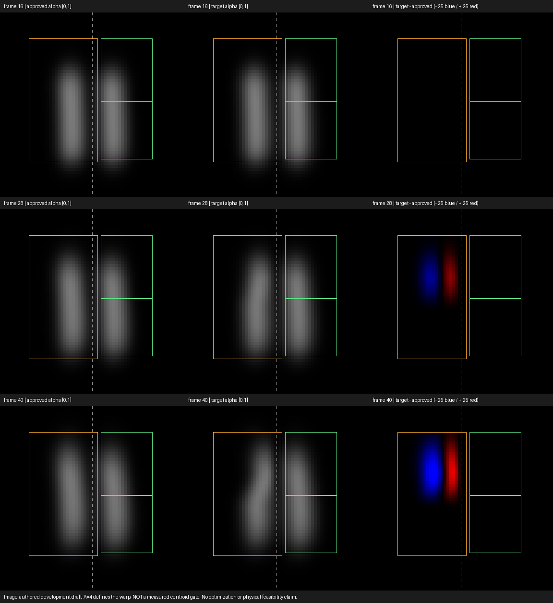

# T02 · 左上弯曲的 authored 目标草案

这是**研究人员编写的 development 图像目标**，独立于优化见证，不是独立人类创作者验证。命题是在帧 16..40 将左烟上部逐渐向画面中缝引导，保留右侧批准画面。未知物理可达性；本轮没有模型 rollout、GPU、拟合或优化，也没有新论文方法。

固定 A=4 输出像素的生成规则见 [RULE.json](RULE.json) 和 [PROTOCOL.md](PROTOCOL.md)。规则/生成器先写入 [freeze.json](run-01/freeze.json)，再进行唯一一次 CPU/Pillow 生成。A 是采样变形幅度，**不是**实际质心门。历史 R22 的 2px 门没有用于 T02 打分，旧负例未改。

## 图像审查



目视固定帧 28/40，左烟上部逐渐朝中缝弯曲，右侧未变；帧 16 完全相同。下部核心基本保留，但“下部不动”只对 y≤28 的精确定义成立，描述性下窗还包含渐变区。末帧上/下窗 alpha 质心位移分别约 +2.22715/+0.09314 输出像素；这些不是物质轨迹，也不是通过标准。

需保留的图像限制：末帧上窗 alpha 总量比约 .831256，目标上部略收窄，不能称质量守恒的纯弯曲。冻结公式没有上侧 y taper，ROI 顶内行 alpha 变化最大 .0340752，紧邻外行变化为零；图像存在局部接缝风险。此次不补 taper、不改幅度、不以数值过门替代视觉审查。该草案可作为普通基线的明确输入，不能因此称已经取得合格物理解。

## 记录到的门与未知项

| 项目 | 本次结果 |
|---|---|
| 全部 25 帧 / alpha | 顺序 16..40；有限且在 [0,1]，实际最大 .479716917 |
| ROI 外、帧 16 | 与批准图逐位相同 |
| 非零图像变化 | 24 帧；不要求帧 16 非平凡 |
| 零控制的编辑门 | 帧 16–21 通过；帧 22–40 不通过 |
| 零控制的保护/力门 | 全部 50 保护项通过；控制/体力为零，无新求解 |
| 新语义资格、创作者验证、物理可达性 | 未定义 / 未验证 / 未知 |

零控制与 target 的逐帧误差都在 [summary.json](run-01/summary.json)，相对误差分母为 target ROI RMS，绝对误差是 alpha RMS。示例：

| 接受帧 | 相对 RMS | 绝对 RMS | 原编辑门（≤5% 且 ≤.01） |
|---|---:|---:|---|
| 16 | 0 | 0 | 通过 |
| 28 | .189472313 | .0356398692 | 不通过 |
| 40 | .398590766 | .0715834635 | 不通过 |

把目标图与它自己比较当然编辑误差为零；这不是可行控制见证。源文件/D01 首尾 SHA 均不变。

## 给后续任务的数据接口

- [run-01/brief.json](run-01/brief.json)：D01 `tog-brief-v1`，`origin=authored`、`role=development`、`semantic_gate=null`。
- [target-edit.npy](run-01/target-edit.npy)：float64 `(25,43,24)`，ROI `[10,12,34,55]`，左下原点 `[frame,y,x]`，帧 16..40；文件 SHA256 `55f81cb5b5c4d88e05d773fe21210635fbf7b601b42bb9b1d10d80f559f05e96`。
- [target-full.npy](run-01/target-full.npy)：float64 `(25,64,64)`，含逐位保留的非编辑区域，供审查。
- 批准帧、v0、rho0：`../../fixtures/r22/approved.npz`，SHA256 `9da9166a209d18cc8256d78f14f13a2a5d834ea5e9936b4d4f58440b92917f09`。不把 witness 文件传给优化器。
- 保护/编辑阈值与 D01/R21 相同。后续 ordinary baseline 必须真实计费，不能因新目标未知可达而预设成功或把预算失败称不可行。

从仓库根目录验证目标规格（不运行模型）：

```sh
python tracks/tog/research.py validate --brief tracks/tog/tasks/t02-authored-upper-bend/run-01/brief.json --require-target
```

生成工具默认只计划。需要独立复现时，先指定一个不存在的输出目录冻结，再执行同一目录；已有 `run-01` 禁止覆盖。这不是额外实验授权或建议再做幅度选择：

```sh
python tracks/tog/tasks/t02-authored-upper-bend/generate_target.py --freeze --out fresh-t02-copy
python tracks/tog/tasks/t02-authored-upper-bend/generate_target.py --execute --out fresh-t02-copy
```

源 generator SHA256 `db1b0e7d3f9a0aac67974823ba0f563a1ee44821dced0dfa8b3a2fbd85e16eb9`。PNG 按固定 [0,1] 灰度显示、差分固定 ±.25，没有后验曝光调节；数值原始数组保留不变。
