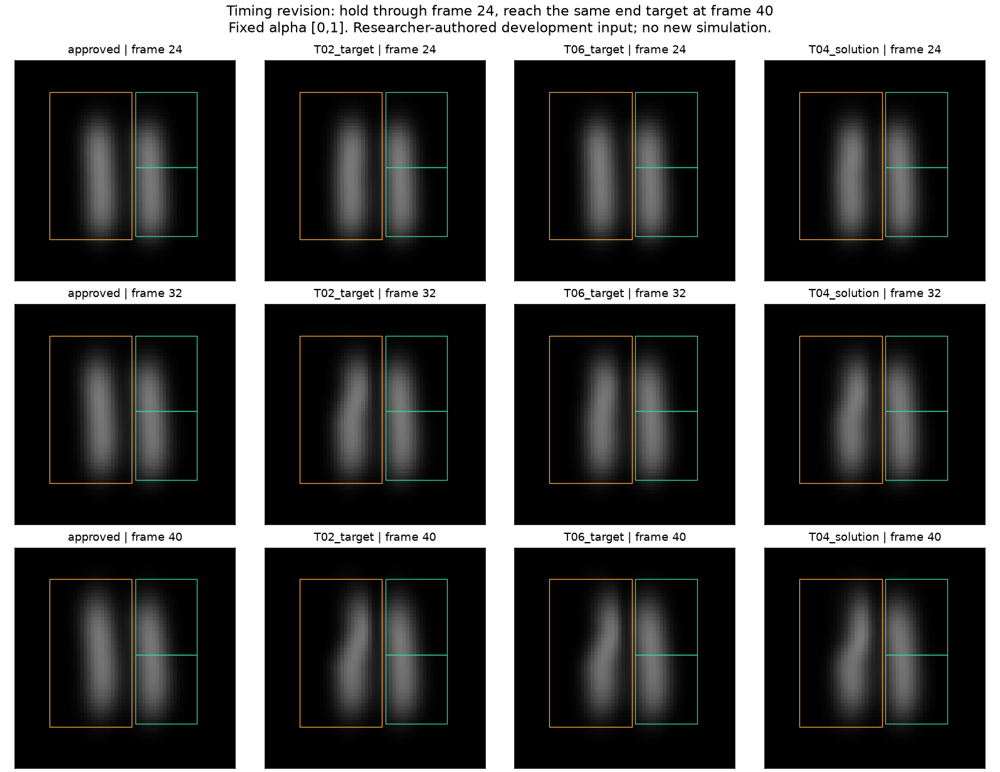

# T06: hold the motion longer, preserve the final bend

One fixed researcher-authored revision was generated on CPU after freezing its rule: the left plume follows each frame's approved image through frame24, then reaches the same frame40 upper bend as T02. The amplitude, spatial envelope, approved input, model and quality gates are unchanged. This delays the applied image deformation; it does not stop the original smoke motion or establish physical retiming. This is the second development edit in the current brief, not a real artist request or an established feasible task.

[Protocol](PROTOCOL.md) · [rule](RULE.json) · [generation freeze](run-01/freeze.json) · [input brief](run-01/brief.json) · [generation results](run-01/summary.json) · [saved-image comparison](review-01/comparison.json)

The generator is byte-identical to T02 and reads approved frames only. It does not read optimized controls or the T04 result. Its single generation completed with unchanged sources. The separate post-generation review then read existing T04 frames; it did not change the target or run the simulator.

Root visual inspection confirms a straight T06 left plume at frame24, a smaller bend than T02 at frame32, and the same endpoint at frame40. Both protected right regions are unchanged in the authored input. Frames16..24 are exactly the approved arrays; frame40 is exactly the T02 target. The inherited image-mass change and upper ROI seam remain. This shows the specified timing edit, not physical reachability or human creative approval.

| Saved input evaluated against T06 | Editing gates passed | Protection gates passed |
|---|---:|---:|
| Zero control / approved images | 12/25 | 50/50 |
| Previously qualified T04 final images | 11/25 | 50/50 |

The T04 images have worst editing relative RMS 12.5127% against T06, so the old qualified result does not already satisfy this revision. These are saved-image evaluations only; no new control or dynamics were generated. Existing T04 controls/physical fields retain their separate qualification. T06 physical feasibility and ordinary revision cost remain unknown.

An independent read-only review also inspected the actual comparison image and source lineage. It cleared this as a bounded warm-start screen, with the distinction between delaying an image deformation and physically retiming smoke made explicit. It did not supply human creative approval.

The next finite optimization needs its own T07 contract. It must allow a previous qualified control, disclose where that control came from, preserve all original quality gates and pay for real verification. A cheap ordinary revision would count against a dedicated response-cache hypothesis. A costly or failed revision would still not establish a new method's necessity. No further target variants are planned within this two-edit development brief.
