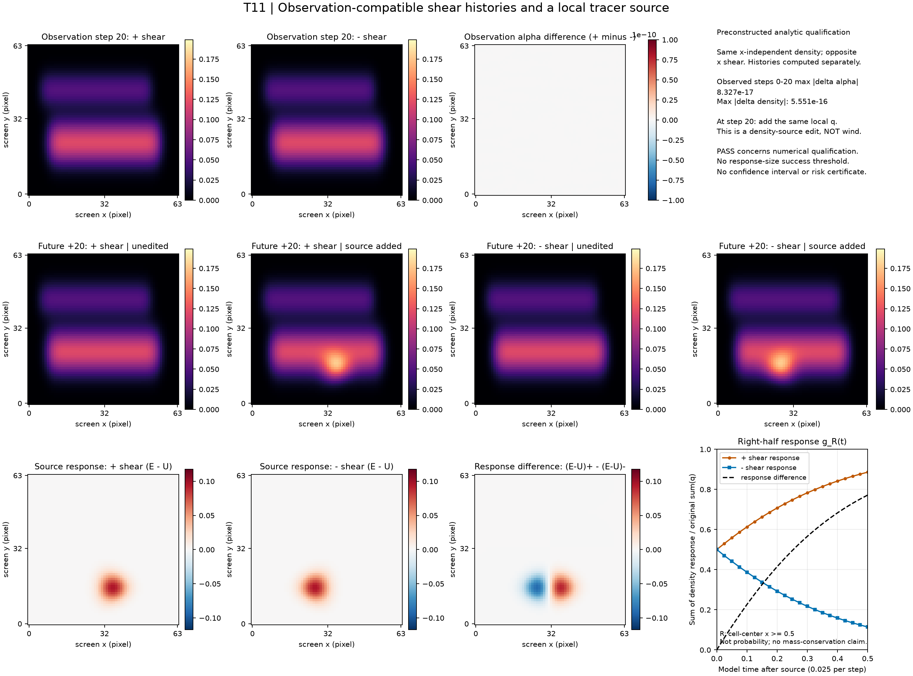

# T11 保存结果：局部示踪源响应

这是一次解析输入的数值资格检查，不是新方法、真实重建或创作效益实验。两个符号分支从各自速度独立推进；相同观测来自事先构造的 x 独立密度，而非从真实照片恢复的唯一解释。



原结果为 `ANALYTIC_QUALIFICATION_PASSED`，完成 120 次原 core.step。观测0–20步的密度最大绝差 5.5511151e-16，alpha最大绝差 8.3266727e-17。末端 g_R(+)=**0.88580559**、g_R(-)=**0.11419441**；末帧两条 alpha 响应最大绝差 **0.09025790**。响应幅度只作描述，没有响应大小通过门。

图的第一行显示观测 step20，第二行是操作后20步（绝对 step40）的四个实际分支，第三行使用 alpha_E−alpha_U，而非 render(q)。各组共用色标，观测差图固定在±1e−10资格门。图像原点在左下；g_R是世界右半区 x≥0.5 的密度响应除以原始 sum(q)，不是屏幕ROI、概率或置信区间。半拉格朗日推进不保证质量守恒。操作是添加局部密度源，**不是风或障碍**。

worker总时长 19.580589 s，监督进程 20.323509 s；观测/续算同步计算含检查、渲染及读回为 0.933481/1.621605 s。这些是一次资格执行成本，不是交互性能比较。

## 数据范围与重画

[compact.npz](compact.npz) 为 4,920,316 B，完整保留两条观测和四条未来的全部21帧alpha、两条alpha响应、g_R及响应质量比、q和四支末密度；所有保留数组与原保存数据逐位相同。未复制完整密度轨迹和速度场，因而这个紧凑发布不能独立重放原PDE或完成全部物理审核。原始NPZ身份、所选数组身份、发布前后来源锁见 [publication.json](publication.json)。[plot-data.json](plot-data.json) 给出曲线、色标及时间含义。

脚本默认仅打印计划，不读取结果或导入绘图库。保持原raw后，可从T11目录运行：

```text
python -I -B publish_saved.py --execute --run runs/run-01 --output publish-NEW
```

需已有 NumPy／Matplotlib，不导入Torch或求解器、不使用GPU；输出必须是全新目录。[summary.json](summary.json)、[supervisor.json](supervisor.json)、日志及冻结合同为原始文件副本。这里的检查只是发布完整性及末端g_R复算，不冒充独立全轨迹物理审核。

此例只证明这套差分观测管线可以呈现已知构造的分歧。它不证明自动发现观测兼容状态、可信覆盖、一般反事实可辨识性或TOG贡献；也不是第三条同类图像编辑目标。

本次实际发布使用已有 gs-sph-3d 解释器，子进程设置 MKL SEQUENTIAL 并加入该环境的 Library/bin DLL 搜索目录，没有导入 Torch 或使用 GPU。首次 bundled Python 因缺少 Matplotlib 在读取输入和创建输出前失败；未安装包，改用已有环境后完成。精确命令和两次结果见 [publish-execution.json](publish-execution.json)。此环境调整没有改变原始数据、图形参数或资格门。
