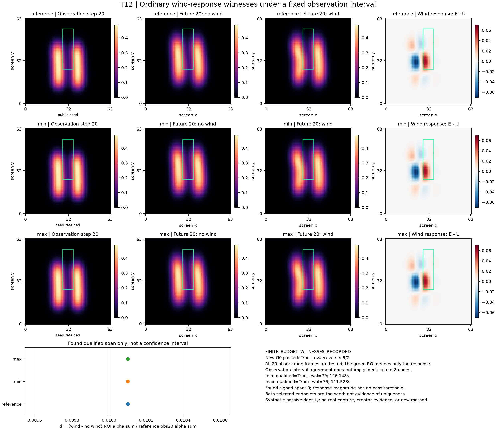

# T12：普通风响应极值搜索的保存结果

原执行状态：**completed**；决策：`FINITE_BUDGET_WITNESSES_RECORDED`。本页只发布实际保存值，不把执行完成、G0通过或 seed 合格当作发现显著歧义。



三行分别为公开reference、min、max的最终核验。第一列为观测step20；之后是future20（绝对step40）的无风、有风及实际alpha差分。所有alpha图共用色标，所有差图共用零中心色标，原点在左下。绿色半开ROI为[28,26,36,56]，只定义响应量；原观测约束覆盖完整20帧全部像素。

| 臂 | 最终qualified | selected origin / ID | 保留seed | 实际d | 完整eval / reverse | 臂耗时s（含末验/IO） |
|---|---|---|---|---|---|---|
| min | True | seed_initial / eval 1 | True | 0.010101999874651837 | 79 / 77 | 126.14822039997671 |
| max | True | seed_initial / eval 1 | True | 0.010101999874651837 | 79 / 77 | 111.52257760002976 |

合格双端可用：**True**；找到的max−min跨度：**0.0**；两端均保留seed：**True**。若两端都是seed，只能说本轮没有选出优于seed的新合格极值见证，不能说区间收敛为零、没有歧义，或仅据最终选择断言每个非seed候选都不合格；后者需独立检查全部实际eval记录。这不是全局极值或覆盖区间，不含任何概率／置信保证。两臂从同一公开seed独立开始，最优见证允许来自实际付费的line-search trial；是否为优化器返回点及重新验证ID见 [result.json](result.json)。只有seed或未得到合格末验时也如实保留。没有响应幅度通过门。

新G0：passed=True，完整eval=9、reverse=2，耗时（含IO）=17.92628270003479 s。完整worker=274.90117879997706 s，监督进程=275.9082256000256 s。所有reference、资格、搜索和末验成本见result/summary；它们不是交互速度胜出证据。缺失／失败项不补造数值。

观测验收针对8bit码对应区间并允许冻结的1e−10 alpha容差，不等于重新量化逐码一致。result分别列区间违反量、码差数量和byteExact。本页以NumPy从实际alpha重算g/d及观测区间指标，不重新求解PDE，不替代独立完整field审核。

## 紧凑数据与复现出版

compact.npz：5,786,157 B；建议5MB内：False。执行前已固定只保留三套完整obs/future alpha、theta，reference observed_uint8/lower/upper/denominator及g/d；**不含3D初速、末密度、风场或完整约束向量**。完整原NPZ文件身份及保留数组raw SHA记录于 [publication.json](publication.json)。保留数组使用原dtype并逐位压缩往返验证，不因大小或结果改变范围。未得到的最终核验不会用best trial或seed文件冒充替代。

在T12目录中，使用已有gs-sph-3d环境：

```text
C:/Users/seanzjxiao/miniconda3/envs/gs-sph-3d/python.exe -I -B publish_saved.py --execute --run runs/run-01 --output publish-NEW
```

默认不加--execute只打印stdlib计划。显式执行时仅在子进程设置MKL SEQUENTIAL和Library/bin DLL路径，使用已有NumPy/Matplotlib，不导入Torch、不启动GPU或新轨迹；输出拒绝覆盖。

这是固定模型和有限预算下的见证搜索记录，不是真实重建、人类创作需求、已辨识真实速度、新优化器或TOG贡献。若没有新的合格见证，不能把搜索失败等同唯一性或专用零空间方法的必要性。
