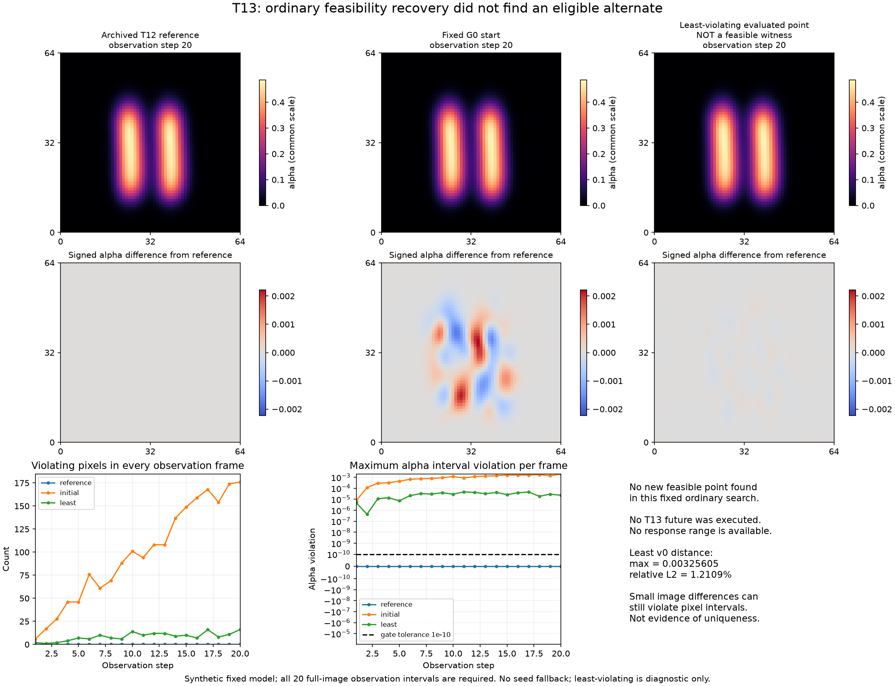

# T13：普通 Phase-I 可行性恢复的保存结果

这次固定普通搜索没有找到新的合格速度点。least-violating 是诊断点，不是可行见证；这不证明不存在其他合格点或观测唯一。

正式决定：`NO_NONSEED_FEASIBLE_POINT_FOUND_WITHIN_FIXED_SEARCH`。新 G0 导数/数值资格：`True`；这与观测可行性是不同判断。



图像均来自实际保存的 alpha，原点 lower-left、公共色阶。差图有明确独立量纲；视觉近似相同不替代每帧逐像素区间门。所有 20 帧的违反量和违例计数在下排及 compact 中完整保留。本次没有执行未来分支或完整 60 步验证；图和紧凑数据不补造未来、零响应、seed fallback 或新响应范围。

| 记录 | 像素—帧违例数 | 最大 alpha 违反量 | v0 最大差 | v0 相对 L2 | d |
|---|---:|---:|---:|---:|---:|
| reference | 0 | 0 | 0 | 0.000000% | 未执行/不适用 |
| initial | 1965 | 0.00191590773011 | 0.00323801339474 | 1.258263% | 未执行/不适用 |
| least | 170 | 4.68968472527e-05 | 0.00325604964723 | 1.210884% | 未执行/不适用 |

速度差相对同一参考初始速度；`max > 1e-10` 仅排除数值同一，不是实质歧义标准。least 的选择沿冻结的全约束字典序，不是按图片最相似事后挑选，也不必是最后一个优化器接受点。

本次总计 87 个完整 20 步 observation（1740 步）、0 个完整 60 步 verification（0 步），实际完成 1740 步、78 次反向。搜索自身 78 个 observation、77 次反向、36 次返回；G0 另计。worker 55.612680 s，supervisor 56.453979 s；不是与 T12 等工作量的速度比较。各分段原值见 [result.json](result.json) 和 [summary.json](summary.json)。

[compact.npz](compact.npz) 保留发布对象完整 20 帧观测、theta、原精度 v0、观测区间及逐帧统计；若实际执行了 final，则保留其两条完整 future alpha。未复制大 3D 末态或密度轨迹，原 raw 身份在 result 中保留。约 5 MB 是记录目标，不因超过目标删证据。所有保存数组逐字节压缩读回，输入/源码首尾 SHA 和输出 SHA 见 [publication.json](publication.json)。本发布的 CPU 数值核对不是独立前向物理复算；独立审计由另一脚本另列，不在此擅称已通过。

复现本出版（仅 CPU，要求带 NumPy/Matplotlib 的既有环境；不运行模型）：

```text
python -I -B publish_results.py --run runs/run-01 --out publish-NEW --execute
```

无 `--execute` 时仅打印 stdlib 计划。fresh 输出拒绝覆盖。执行进程局部设 MKL sequential 和 Conda Library/bin DLL 搜索，不修改全局环境、不导入 Torch。原 T12 [publication](../../t12-ordinary-wind-response-extrema/publish-01/README.md) 仅提供认证参考；没有借用 T12 搜索终点作为 T13 候选。
