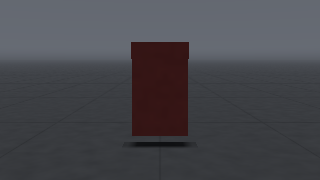

# Native final composite delivered on the neutral external solver

The original Blackbody classic stage rendered the unheated T131 fabric at frame 2, with final quality and the T130 camera settings. The RTX 5070 Laptop D3D12 process took **216.554 s** from launch through exit. The native render used one original `main` dispatch with 39 resources and 40 × 23 × 1 workgroups. The native caustics descriptor was requested during construction. Its key and expanded WGSL hash matched the registered values, and the pipeline remained unmaterialized. [Registered trial](PROTOCOL.md) · [Native dispatch record](evidence/STAGE.ndjson) · [Compiler and driver record](evidence/COMPILER.json)

The lossless native measurement is a **320 × 180 × 4 float16 scene-linear array**, SHA-256 `d8a43bc1270ac6f1a9ae671aa4ed0b078e0020535950139a20bc11554b624816`. All 57,600 pixels have nonzero RGB. RGB ranges from 0.004635 to 0.173096. Alpha is 1 everywhere. The PNG above clips linear RGB to [0,1], applies the standard sRGB transfer at unit exposure, and rounds to eight bits. No RGB sample required clipping. [Native pixels](evidence/composite.npz) · [Preview conversion](preview.py)

The native on-disk checkpoint restored the archived frame 2 before rendering. The measured pre-draw gas, cloth, ember and pending feedback fields match T131 across 11 numerical arrays. The corresponding physical state also matches the independent T130 successor receipt. Both frame and solver step remained at 2 through readback. This demonstrates one complete external-solver composite on the neutral fixture. Neither prior FXC attempt returned a native composite for a pixelwise cross-compiler comparison. No alternate branch, artist judgment, final edited playback or end-to-end speed improvement was measured. [State and image verification](evidence/SCORE.json) · [Restored frame](evidence/RESTORED.json)

| Timed operation | Wall time |
| --- | ---: |
| Classic `create_compute_pipeline` | 205.312 s |
| Complete eager stage preparation with on-demand caustics | 205.436 s |
| Neutral scene preparation | 4.917 s |
| Restore measured frame 2 | 0.059 s |
| Prepared native composite call | 0.514 s |
| Synchronous linear readback | 0.0018 s |

Phases are nested where applicable. The host was awake for 216.554 s, and the worker exited below its 420 s deadline. These single-process clocks include unknown driver-cache effects. T138 measured 242.535 s for the same classic compute-pipeline creation and stopped during eager caustics construction. The difference between these classic times does not establish a controlled speedup. [Phase clocks](evidence/PHASES.ndjson) · [Supervisor](evidence/EXIT.json) · [Previous eager attempt](../t138-dxc-module-labels/README.md)

## Reproduce

Run `python check.py` with NumPy for the complete offline check. It verifies the held compiler/label receipts, original stage key, actual return of the native dispatch, source identities, successive reference states and every native pixel. With Pillow, `python preview.py evidence/composite.npz neutral.png` reproduces the display preview. For another native run use the pinned T135 SDK/driver environment and T130 Python runtime, then run `python classic.py --source BLACKBODY_CHECKOUT --out NEW_DIRECTORY`. Only the single unused native caustics descriptor is deferred. If code dispatches it, the original kernel is created on demand and the normal native dispatch proceeds. [Operator](classic.py) · [Offline checks](check.py) · [Original source](https://github.com/gjnail/blackbody/blob/e2ac951dbfabc6060073943e4c344439ac5f4555/blackbody/engine/stage.py#L795-L805)
