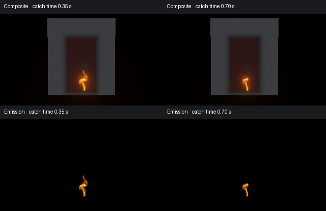

# The two restored curtains in the released camera

The original final compositor drew both externally simulated frame-36 states. The only scene edit doubled the sustained-heating time needed to ignite the curtain. The differences in the image are concentrated at the base of the sheet. Both versions still show a flame from the common lighter. The investigators chose the parameter comparison and that frame.

| Original 320 by 180 view | Catch time 0.35 s | Catch time 0.70 s |
| --- | ---: | ---: |
| Summed scene-linear emission luminance | 78.765 | 47.933 |
| Peak emission luminance | 2.072 | 1.328 |
| Emission pixels with luminance at least 1 | 13 | 5 |
| Summed final composite luminance | 816.438 | 750.383 |

In the final composite all 57,600 pixels differ in at least one original half-float RGB word. At fixed exposure, 49,647 pixels differ by at least one display code, and **644 (1.12%)** differ by at least 16 in any channel. The sum of the signed final luminance changes (0.35 s minus 0.70 s) is 66.055; the sum of their absolute values is 75.300. In the separate emission pass 295 pixels exceed or equal 16 display codes of change. This comparison establishes a measurable change in the investigated shot. It supplies no preference or perceptual threshold from a viewer.

Both native states were compared to independent ordinary simulation before and after each draw, including gas, material, clocks, object heat, radiant feedback and embers. No physics step was permitted during rendering. The native stage submitted its original classic main shader once for each final composite. Each image retains all four linear float16 channels at the registered size. Display conversion clips RGB to [0,1] and applies the standard sRGB transfer and nearest 8-bit rounding at exposure 1. The public scene is procedurally defined in the pinned Blackbody checkout.

The single renderer process took 313.22 seconds including cold D3D12 compilation, two restores, four native draws, image readback, state verification, and data writing. The same stage pipeline served both composites. This single process measures the cost of acquiring these records.

Recompute the table, all pixel differences and the display sheet with `python -B score_images.py` (NumPy and Pillow). To regenerate the images on the compatible NVIDIA/D3D12 host, first complete both T154 processes and retain its verified packets. Set the same runtime path, then run `python -B images.py --source CHECKOUT --out NEW_DIRECTORY` followed by `python -B score_images.py --out NEW_DIRECTORY --write`. [Protocol](PROTOCOL.md) · [Original linear RGBA and receipts](evidence/) · [Native camera render setup](images.py) · [Exact state restoration](../t154-native-surface-fork/)
