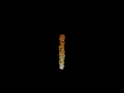
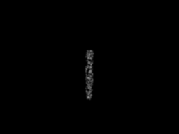

# T36 — qualified new ordinary RGB delivery

Completed 30 October 2026. One ordinary-only invocation produces a qualified new 256×192 frame against the intact T35 reference intervals. All 49,152 saved pixels pass; T35 remains a failed RGB delivery. The new blue channel was recomputed, not recovered from the corrupted T35 field. This repairs output delivery, not the scientific model or contribution.

The [protocol](PROTOCOL.md), [20-input freeze](freeze.json), [pre-execution review](../../../validation/t36-pre-execution-review.md), and [18-check storage test](../../../validation/t36-storage-test.json) precede the sole scientific invocation. Independent [saved-output audit](../../../validation/t36-saved-output-audit.json) and [review](../../../validation/t36-saved-output-review.md) verify 884,904 conditions with zero failures, without another scientific evaluation. The frozen implementation and historical evidence remain unchanged.

## Actual saved image and limits

The original-size display contains a narrow yellow/white particulate column against black. Alpha≥0.001 occupies 986 pixels, 2.006% of the full frame, within x=120..135, y=70..144 (16×75). This is a small authored development field. Its particle appearance and limited coverage do not supply a complex scene, a creator brief, a physical fire claim or audience evidence. No crop, zoom, exposure fitting or new scene was used to make it look more substantial.

| Saved-output quantity | Result |
|---|---:|
| Qualified / planned pixels | 49,152 / 49,152 |
| Failed, invalid or uncomputed pixels | 0 |
| Maximum R / G / B distance to both reference endpoints | 0.0006406100 / 0.0009802000 / 0.0009948458 |
| Maximum alpha error | 0.00001341486 |
| Maximum alpha | 0.5487233 |
| HDR maxima R / G / B | 1.2060765 / 1.0699881 / 0.8202146 |
| Ordinary zero / color-box / GL paths | 47,782 / 375 / 995 |
| Reused mixed-source flags | 956 |

All intact old R/G/alpha values, retained counts, ordinary paths/orders, omission charges and pruning deltas reproduce exactly. Geometry is compared with the original normalized tolerance; the independent clip residual reaches 0.0004863446 against the limit 1, without requiring bitwise agreement between different ray implementations. The three new RGB channels satisfy the unchanged 0.001+1e-10 endpoint/range gates. PNG channel encoding is independently checked against decoded saved HDR values. Binary64 qualification on this fixed frame is not a formal floating-point certificate.

Source-level projection and omitted-mass evidence are inherited from T35 under unchanged input/code/runtime and deterministic reproduction; new source arrays were not independently regenerated. The old reference construction is independent of ordinary RGB; old output affected its stopping only. Consequently its intact intervals can qualify new output without being rebuilt. This is reuse of experimental comparison evidence, not a rendering-cache method.

## Full paid cost

| Stage | T36 seconds |
|---|---:|
| Ordinary projection and pruning | 2.6980736 |
| Ordinary solve | 118.6531910 |
| Saved reference comparison | 1.2727273 |
| Streaming write and readback | 2.1179807 |
| All computation | 125.5684367 |
| Decoded validation, compression and PNG packaging | 1.1715231 |
| Supervisor wall time | 126.9385287 |

The original failed T35 delivery already paid 568.3149198 supervisor seconds, including 123.4648511 for ordinary preparation/solve and 432.6906232 for independent projection/reference. T35+T36 therefore paid 695.2534485 supervisor seconds across two scientific invocations; T36 adds zero reference invocations. These are development costs, not a speedup experiment or FPS. Per-stage timings include small progress writes, and observed timing differences between the two invocations are not benchmark conclusions.

Ordinary work counts exactly reproduce T35: 995 GL pixels, 187,295 integration segments, 2,247,540 integrand evaluations, 94,390,440 source-PDF evaluations and 188,864,932 normal-CDF calls. Only two unit GL rules were built. The current scalar kernel scans all retained sources at each node of source-derived intervals, typically quadratic in retained source count; Python object/loop overhead and repeated fixed-endpoint work remain unseparated. These costs cannot establish an optimized-renderer bottleneck.

## Preserved evidence and decision

The `<13d6I` schema has 19 unique explicit fields, including separate `rgb_b` and `ray_far`. Every written payload is read back before status commit, then decoded saved-output gates are repeated before final success. The structural sentinel test deliberately replaces blue by far clip and verifies rejection. Its 18 checks are non-scientific storage tests.

The [pixel gzip](run-01/pixels.bin.gz) is 1,212,661 bytes, SHA256 `0450c3ffee1b8d9a4afad17ff1467c0e1f8e9cbee6418b8f8933bb9d7990d3e6`; its raw 6,291,456 bytes have SHA256 `99278f52bfa61f792172b0acf3db255940f837f0a2077770647e302e42795f0e`. Total new raw numeric evidence is 6,298,888 bytes, below 32 MiB. [Execution](run-01/execution.json) records no timeout, error, retry, recovery or live child. [Result](run-01/result.json) preserves counters, source checks, prior paid costs and actual output extrema. The independent [auditor](audit/audit_saved.py) imports no scientific modules.

T32/T33 remain failed, T34 subset-qualified, T35 failed in persisted RGB. All 420 prior artifacts are retained byte-for-byte; only the three current-state documents change. Art, main and deleted automation remain untouched. The [next entry](NEXT_ENTRY.md) must test whether this actual workload requires expensive continuous-color integration before new-method engineering. No further frame, scene, candidate or numerical protocol is queued here. The research goal remains active; TOG contribution is unestablished.
