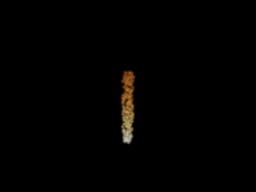
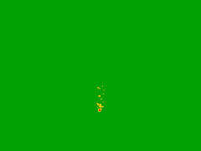
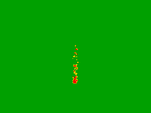

# T37 — cheap ordinary rules nearly cover the narrow first frame

Completed 30 October 2026. One complete two-arm screen finds definite accuracy failures in both ordinary approximations, but very limited displayed consequences on this acquired frame. Sorted whole-primitive composition has only four definite-failure pixels, in a2×2 region; its maximum fixed-display difference from T36 is one8-bit code value. Neither rule passes every pixel, and unresolved pixels remain unresolved. This supplies workload evidence, not a new rendering method or a strong-baseline failure.

The [protocol](PROTOCOL.md), [26-input freeze](freeze.json), [pre-execution review](../../../validation/t37-pre-execution-review.md) and [23-check literal storage test](../../../validation/t37-storage-test.json) preceded the single scientific invocation. The [independent saved-output audit](../../../validation/t37-saved-output-audit.json) checks1,917,160 conditions with zero failures. [Review](../../../validation/t37-saved-output-review.md) preserves the distinction between a completed screen and accurate output. No method, reference or scientific invocation was repeated during auditing.

## Complete distributions

Use original frame90/front,270 primitives,256×192, unchanged HDR/clip/pruning semantics and tolerance0.001+1e-10. Qualified means all three channels are close enough to both saved reference endpoints and alpha passes. Definite failure means at least one channel is farther than tolerance from the entire reference interval, or alpha fails. Everything else is unresolved; the reference midpoint is never substituted for truth.

| Ordinary rule | Full frame qualified / definite failure / unresolved | Fixed986-pixel foreground qualified / failure / unresolved |
|---|---:|---:|
| Mean-depth whole-primitive composition | 49,097 / 4 / 51 | 931 / 4 / 51 |
| Optical-mass-weighted color × total alpha | 48,956 / 78 / 118 | 790 / 78 / 118 |

All98,304 output records are valid and complete, and alpha passes on all pixels in both arms. No execution failure, malformed record or unfinished pixel occurs. Every definite failure and unresolved pixel lies in the fixed original foreground. Because97.99% of the image is outside that foreground, whole-frame pass counts alone would exaggerate usefulness; both denominators are shown.

| Extent / numerical quantity | Sorted | Mixture |
|---|---:|---:|
| Definite-failure bounding box, inclusive x/y | [126,139,127,140] | [123,78,131,141] |
| Maximum distance to reference interval | 0.0034961710 | 0.0221243915 |
| Maximum distance to both endpoints | 0.0053557844 | 0.0241010376 |
| Maximum alpha discrepancy | 0.00001341486 | 0.00001341486 |
| Pixels whose fixed display differs from T36 | 51 | 155 |
| Foreground pixels whose fixed display differs | 38 | 142 |
| Definite-failure pixels whose display differs | 1 of4 | 57 of78 |
| Maximum absolute8-bit display-channel difference | 1 | 2 |

T36 is a qualified approximation, not exact truth. Display-code differences do not establish perceptual indistinguishability, viewer preference or temporal quality. The four sorted failures remain numerical failures even when three quantize to the same display values. No tolerance was loosened or historical gate reinterpreted.

## Original-size outputs

Sorted ordinary output:

Mixture ordinary output:

Sorted and mixture classifications, respectively; green=qualified, red=definite failure, yellow=unresolved. The large green background is not evidence of a demanding solved task.

Both ordinary RGB images retain the narrow yellow/white particle column seen in T36. Full-size unamplified display-difference images are saved with the evidence. No crop, zoom, exposure fit, favorable view or input modification was used. These images support a limited static workload assessment, not a physical fire or creator-demand claim.

## Paid work and limits of timing

Each arm independently builds its own tree and camera and evaluates all rays, projections, finite masses and outputs. Neither receives reference endpoints, old RGB or the other arm's numerical results. The sorted rule orders by projected mean/source ID and uses a compensated prefix sum; the mixture rule does not sort. Both are ordinary approximations already known in this exploration, not new formulas.

| Stage, seconds | Sorted | Mixture |
|---|---:|---:|
| Tree and camera | 0.0022902 | 0.0033640 |
| Ray preparation, projection and pruning | 2.5062296 | 3.1083412 |
| Finite masses and output | 1.3357101 | 1.4404178 |
| Reference comparison outside delivery | 1.2888558 | 1.5964939 |
| Streaming storage/readback | 2.0036910 | 2.4895142 |

Complete computation takes17.2413524seconds, decoded validation/packing2.8086605seconds and supervisor wall time20.2389275seconds, within60/90/10-second limits. Timing includes instrumentation and follows sorted then mixture without repetitions or randomized order. The mixture's larger observed output time despite fewer operations illustrates why this single pass does not establish a performance ranking. Do not turn the difference from T36's scalar GL cost into a benchmark speedup.

Each arm performs42,026 finite normal-interval evaluations /84,052 CDF endpoint calls and independently pays89,514 BVH node visits and42,026 projections. Sorted additionally pays1,370 sorts,42,026 composed components and196,299 prefix-expansion steps. Mixture pays42,026 weighted components without sorting. No GL nodes, reference integrations, new scene, simulation or GPU work occur. Counters describe explicit operations and sum input sizes, not hidden erfc/fsum/sort/interpreter work.

T35/T36 already paid691.6004373seconds of computation and695.2534485supervisor seconds. Including T37 gives708.8417897computation seconds and715.4923760supervisor seconds across three scientific invocations. Earlier failed delivery and expensive reference costs remain paid; no fresh reference is generated here.

## Evidence and decision

The [pixel gzip](run-01/pixels.bin.gz) retains every output, timing and classification:2,151,032compressed bytes, SHA256 `9f54dc3b432a617e3e81999cd073445ceddbbbcf4c5acffd0b33ffce2017a0c7`; raw11,796,480bytes, SHA256 `fc3008f07c67ad1c9c59fe1f170ae818b467f590259c4747a8f6163fffb57ae2`. Raw numeric total11,808,775bytes is below16MiB. [Execution](run-01/execution.json) has zero timeout, error, retry or live child. [Result](run-01/result.json) preserves all counters, per-arm stages, classifications and prior paid costs. The [independent auditor](audit/audit_saved.py) checks stored scalar algebra and display encoding without evaluating a method, projection, CDF or integral.

Both rules definitely miss the original numerical gate, so neither replaces the qualified continuous output as an all-pixel accurate solution. However, sorted's errors are confined to four pixels and its entire display differs by at most one code value. This evidence weakens the case for investing in a novel integration certificate on this carrier. It does not prove perceptual equivalence or that a different meaningful task has no bottleneck. The [next entry](NEXT_ENTRY.md) uses that distinction to choose further research, rather than automatically launching compiled GL or another favorable frame.

All451 prior evidence artifacts remain unchanged. T32/T33/T35 failures and T34/T36 qualification scopes stay sealed. Main/art and deleted automation remain unchanged. The full goal remains active; useful core method, strong baselines and independent meaningful workloads are still missing.
