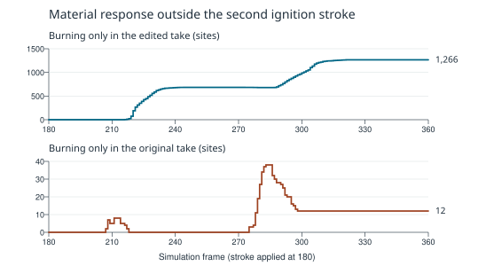

# Previewing the footprint of a second ignition

The editor adds a second stroke at frame 180 of a cached shot and wants to inspect the material sites that will burn differently three seconds later. Under the original per-layer admission rule, adding the 288 directly hit sites to the cached endpoint gives the exact edited burning set. Under global pooling, **1,266 further sites gain burning status and 12 lose it** at the endpoint. Of the five sampled preview lengths, 150 of the 180 suffix steps first recover both sets exactly. This was a researcher-authored shot revision on one woodpile at seed 11. Both policies share the shot and the common prefix. [Frozen protocol](PROTOCOL.md) · [T81 reference](../t81-firewoods-capacity-causality/RESULTS.md)

## When the two takes diverge

Each panel compares the edited and original global-pool takes **at the same frame**. The first off-stroke discrepancy occurs at frame 207, with two sites burning only in the original. The first three off-stroke gains appear at frame 216. The last new ignition in the edited take occurs at frame 321. Of 129 off-stroke sites that newly ignite in both takes, four ignite earlier after the edit, 69 at the same frame and 56 later. The median shift is zero frames, the interquartile interval is 0 to +6, and the range is −58 to +21. The 3,374 pre-existing burners were already active at the start of this window. A site still unlit at frame 360 could ignite later. Counts refer to material splat IDs, each with equal weight. [Frame-by-frame counts](CLOCK.json)

## Ordinary spatial previews

Each rule starts with the cached A-only endpoint and the direct stroke. We score gains outside the stroke among 30,884 cold candidates in the global take. The sphere rule uses distance to the nearest directly ignited center. The upward-ray rule follows the native layer geometry and measures distance to the closest upward half-line at an emitter's quantized layer depth. Both deployed rules use the original flame heating support radius of 0.14 world units.

| Global-pool rule | Correct gains | Extra predicted gains | Missed gains | Gain IoU | Best possible IoU in this distance ranking |
| --- | ---: | ---: | ---: | ---: | ---: |
| Direct stroke overlay | 0 | 0 | 1,266 | 0.000 | — |
| Sphere | 327 | 951 | 939 | 0.147 | 0.279 at radius 0.19723 |
| Upward rays | 1,227 | 2,030 | 39 | 0.372 | 0.438 at radius 0.07513 |

The last column uses edited endpoint labels and searches every distinct threshold with whole ties and an empty prediction allowed. It bounds these particular rankings retrospectively. All three union rules retain the 12 cached burners absent from the edited endpoint. Under per-layer admission there are zero changes outside the stroke. The spatial extensions add 1,278 and 3,257 false positives there. Both scripts record undefined precision and recall as null. For an empty prediction and empty target, the spatial script sets IoU to one and the clock script records null. [Spatial counts, scores and input hashes](SPATIAL.json)

## Progressive preview and its cost

This comparator advances the edited native simulation through a chosen cutoff and holds the observed burning set to frame 360. The table scores that prediction against the **endpoint** change in the global take. These counts differ from the two time series above, which compare contemporaneous states.

| Suffix steps used | Fraction of steps | Step + render + GPU wait (s) | Off-stroke gains found / 1,266 | Correctly predicted losses / all predicted losses |
| ---: | ---: | ---: | ---: | ---: |
| 0 | 0% | 0.000 | 0 | 12 / 141 |
| 60 | 33% | 0.998 | 675 | 12 / 49 |
| 90 | 50% | 1.549 | 680 | 12 / 49 |
| 120 | 67% | 2.184 | 988 | 12 / 12 |
| 150 | 83% | 2.818 | 1,266 | 12 / 12 |

Every predicted off-stroke gain in this table is correct because active sites survive to the endpoint in these archived takes. Taking the union with the cached A endpoint keeps the same gain counts and removes all predicted losses at every cutoff. The complete edited suffix measured 3.419 seconds of step plus render and GPU wait. At the exact sampled cutoff, the observed component saving is 0.601 seconds (17.6%). The last ignition at frame 321 was identified using the full take. Using it as a stopping rule would require an online certificate.

The cached A take is an explicit workflow input. Producing its global suffix previously cost 3.348 seconds for the same step-and-render component, or 16.331 seconds for its entire instrumented arm including the common prefix and exports. The corresponding edited full arm took 16.529 seconds. T81's complete four-arm worker took 66.788 seconds. The T84 offline clock command took 2.419 seconds of shell wall time for four arms. The spatial evaluation measured 0.924 seconds including asset and archive decoding, geometry, label scoring and the threshold search. Measurement scopes differ. An editor would also pay for cache access and mask construction, and would need a movable checkpoint or a replay of the prefix. These archived projections support retrospective evaluation only. [Original timing scopes](../t81-firewoods-capacity-causality/EXECUTION.json)

## Recovering event time from two records

Each burning site consumes one binary32 fuel increment per step. We tabulate the reachable fuel values from each observed post-edit fuel using the native subtraction and round-to-float32 order. The endpoint identifies the number of active steps exactly in this window. The post-edit snapshot distinguishes an immediate click from ignition on the first following step. The completed endpoint contains no retired sites, the native spent state is absorbing, and the takes have no resets during the suffix.

A second reconstruction uses the endpoint's ordered frontier. New sites are appended in PLY-index order within each threshold scan. The difference in successive native clock-work counters supplies each frame's active count, which cuts the endpoint frontier at the end of that frame. The new group of IDs agrees exactly with the fuel-derived IDs and their order in all 720 arm-frames. Starting from the saved service cursor then reproduces all 34,560 offered emitter IDs in order and every final cursor. The scripts check archive content hashes before decoding.

The first 1,400 graph sources remain the same in each matched pair at every suffix frame. Consider replaying the original A gas heating while applying the B stroke. At the start, material state agrees outside the direct stroke. Each off-stroke recipient then sees identical selected gas inputs, identical ordered graph donors and identical local clock updates. Its state and heat continue to agree by induction. B adds burners beyond the served prefix, the directly lit sites remain burning throughout the interval, and the cached-A-plus-stroke overlay therefore describes this one-way baseline's active set exactly. The global off-stroke differences require changed gas feedback in the native coupled execution. The paired experiment includes scheduling, conditional RNG and particle motion together. The per-ID comparison identifies the total edit effect and does not identify unique heat ancestry.

## Use the saved results

From the repository root, Python 3.9+ can verify the time reconstruction and scores using only the committed archive. For spatial rankings, supply the original 34,687-point Firewoods foreground PLY and NumPy. The script checks the PLY against its SHA256 in the manifest of spatial inputs. The compiled scores and figure are committed for readers without the asset.

~~~sh
python tracks/tog/tasks/t84-ignition-edit-footprint/clock_preview.py
python tracks/tog/tasks/t84-ignition-edit-footprint/spatial_preview.py --asset /path/to/foreground.ply
~~~

The optional figure generator reads CLOCK.json and uses ReportLab. Its two panels use different labeled vertical scales to show both directions. [Plot source](plot_footprint.py)

The progressive result leaves a concrete question for T85. How many frames after the edit can the cached take certify exactly before an emission could change gas evolution? T85 compares a source-identity stopping rule with one that accounts for admission and RNG outcomes. [T85 protocol](../t85-edit-prefix-certificate/PROTOCOL.md)

## Per-site event table

The [compressed CSV](material_onsets.csv.gz) contains 8,731 rows: 3,662 per-layer and 5,069 global. Each row gives a stable material ID, the policy, a direct B indicator, and separate frame and status columns for the A and AB takes. Each policy includes every site active in either take within frames 180–360. IDs absent from its rows stayed unlit in both takes over the window. An ID can appear once under each policy.

`left_censored` records a site already burning when first observed at frame 180. `direct_stroke` marks an AB ignition by the edit at frame 180. `observed` gives the reconstructed first burning frame during 181–360. `right_censored` has an empty frame and means unlit through frame 360. When computing paired onset shifts, use only the statuses relevant to the chosen time window. The table contains material IDs and simulated events without scene geometry.

Regenerate or verify the export with standard Python using `python tracks/tog/tasks/t84-ignition-edit-footprint/export_onsets.py`. The exporter reads the public archives, checks the paired timelines against CLOCK.json, then parses the emitted CSV and reproduces the frame counts and progressive endpoint metrics. The uncompressed UTF-8 CSV SHA256 is `5562244904f1fb68b78b717c103afb8505b3953602c111fee82f08c2e929c721`.
