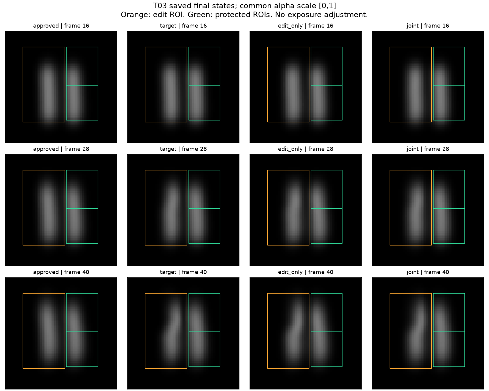
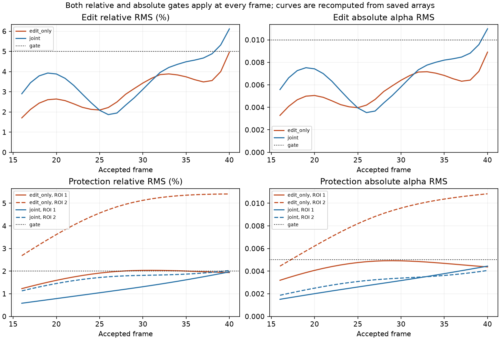

# T03 saved-result visual review

Root review on 27 October 2026. [Numerical outcome and final arrays](../../tog/tasks/t03-ordinary-conflict-screen/README.md) and [independent CPU audit](../t03-review.md) are separate from these plots. No model trajectory was rerun to draw them.



The root inspected these fixed frames 16, 28 and 40 at a common alpha range [0,1]. Both results visibly bend the left upper plume. Visual proximity does not override the per-frame gates: the joint result still fails two editing frames and one protected frame. This is a synthetic passive-smoke image task, not artistic or physical validation.



The quality plot recomputes RMS directly from saved frames and target arrays. Both the relative and absolute threshold must pass at every relevant frame. The two final results are the last accepted solver states, not selected best snapshots. There are no error bars or comparative speedup claims for this single run.

## Plot provenance and reproduction

[plot-record.json](plot-record.json) identifies the complete local archive used for the first successful plot. Those local `runs/` paths are not included by a clone. The corresponding published final bundles are byte-identical. [reproduction-record.json](reproduction-record.json) pins the clone-contained inputs; rerendering from them produced byte-identical PNGs. The plotting script now defaults to that portable input set:

```sh
python tracks/validation/plot-t03.py --out a-new-plot-directory
```

It needs NumPy and Matplotlib, not Torch. Use an activated compatible runtime. In this Windows Conda environment, the first drawing attempt exited with code 1 and no console diagnostic after creating an empty output directory. A diagnostic import check succeeded with the runtime `Library/bin` on PATH and child-local `MKL_THREADING_LAYER=SEQUENTIAL`. The next invocation correctly refused the existing directory; a fresh directory then completed. No numeric data, target, gates or solver run were changed. This record retains the plotting/environment failures instead of presenting them as solver failures.
