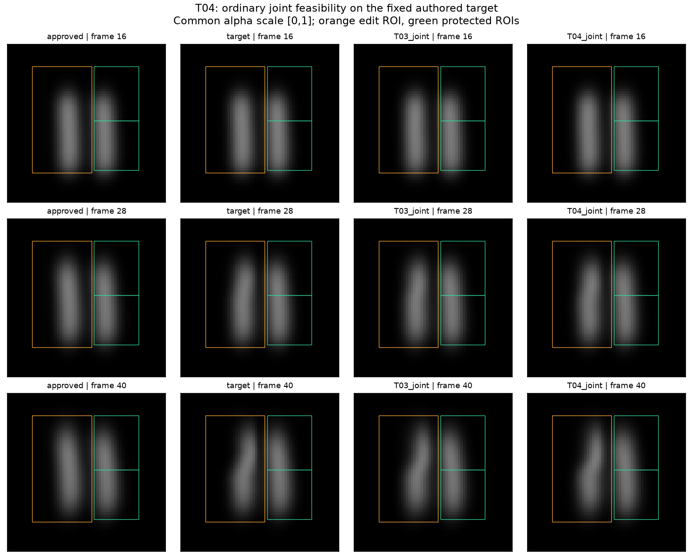
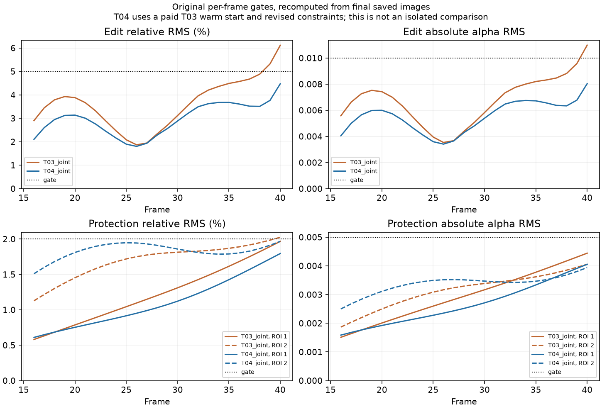

# T04 saved-result figures

Generated 27 October 2026 with [plot-t04.py](../plot-t04.py), using only the published final bundles. No simulation, optimization or timing run was performed. [plot-record.json](plot-record.json) records script/input/output hashes and independently recomputed image-gate counts.

Root visual inspection: the target's upper bend is present in the final T04 frame; both protected right-hand regions retain their approved appearance within the quantitative gates. Images share the original alpha scale [0,1], without exposure adjustment. The 64×64 passive-smoke example is a development fixture, not a production rendering or an artist study. Small differences between T03 and T04 are better assessed through the curves below than by this contact sheet.

All 25 editing frames and 50 protected ROI/frame checks pass in T04. T03's final 23/25 and 49/50 record is unchanged. T04 uses T03's paid warm start, extra budget and revised constraints; these figures do not isolate the cause of improvement or demonstrate acceleration. The [independent audit](../t04-review.md) additionally checks controls, saved trajectories, qualification and cost lineage.

The plotting command completed on its first invocation using the declared local numeric runtime with `MKL_THREADING_LAYER=SEQUENTIAL` and that runtime's `Library/bin` on PATH. A fresh output directory is required. Figures were actually opened and inspected after generation.
