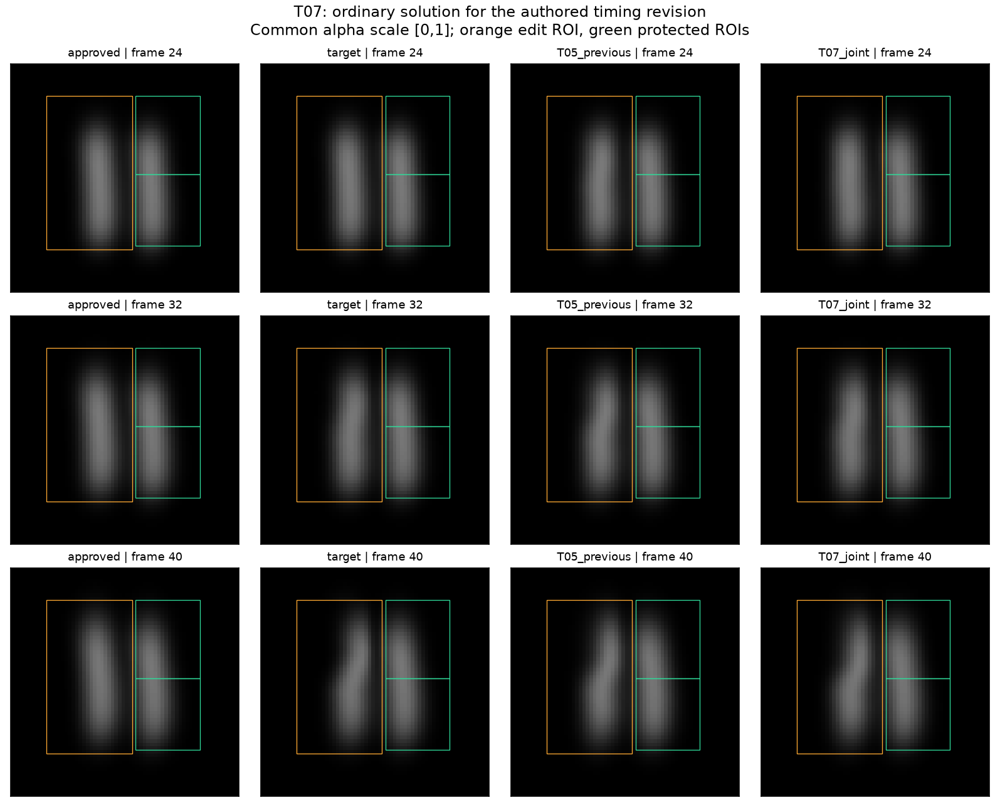
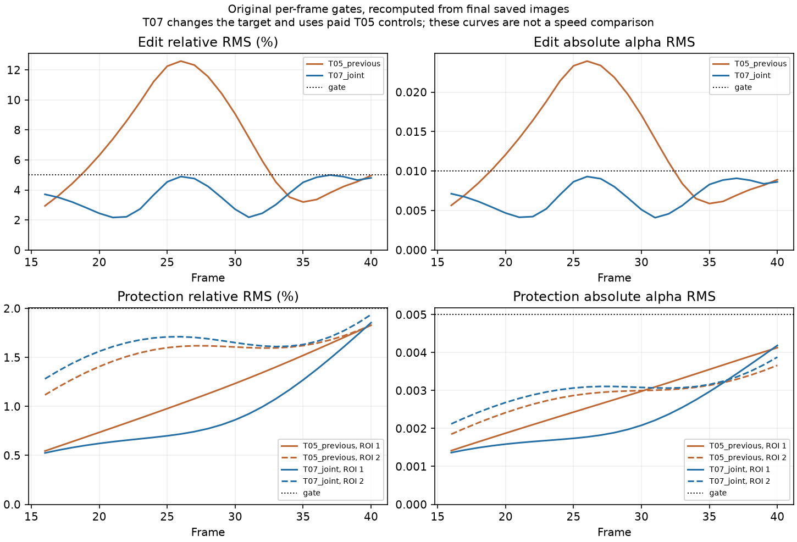

# T07 saved-image review

[plot-t07.py](../plot-t07.py) reads the published T05/T07 final bundles and fixed T06 target. It runs no simulation. The plot completed once, using the declared numeric runtime and sequential MKL environment. [plot-record.json](plot-record.json) pins all sources and reports image-gate counts; both figures were opened and visually inspected.

The old T05 control visibly bends the plume too early for the new target. T07 reduces that early change and preserves the late bend. All panels use alpha [0,1], identical framing and no exposure adjustment. This confirms the intended image difference at sampled frames, not physical retiming, external creative value or production visual quality.

Recomputed image checks: old T05 control passes 11/25 editing and 50/50 protection checks against T06; T07 passes all25/50. The worst edit relative error is close to its unchanged5% bound, and the upper protection ROI remains close to2%; success is at the original numerical tolerances, not a large safety margin. Control and physical-field validity, new G0 and cost are separately covered by the [independent audit](../t07-review.md).

T05 and T07 solve different targets. These curves do not measure a speedup. The T07 ordinary solve used101 forwards and71.190 seconds with the audited acceptance-forward policy; redundant ordinary evaluations are investigated separately in T08.
